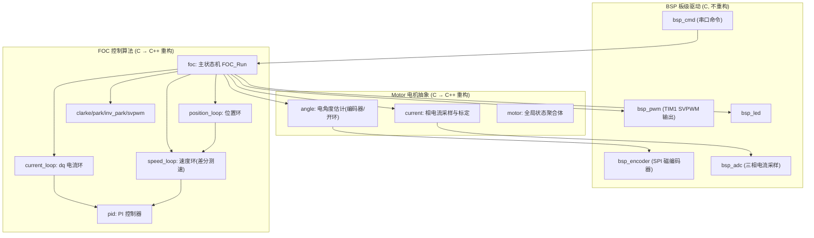
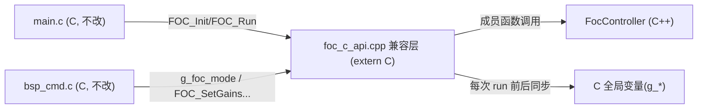
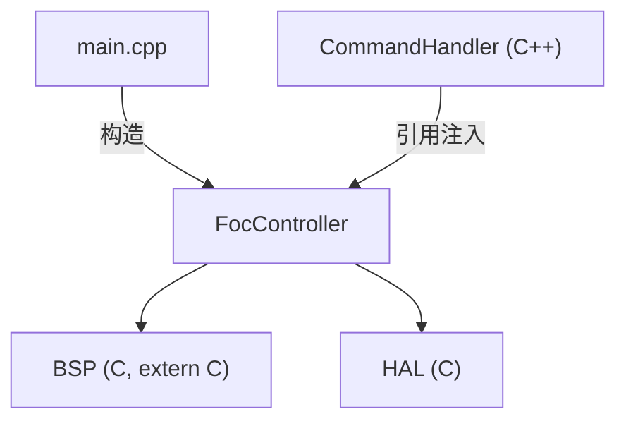

# 把 FOC 代码从 C 重构到 C++ —— 完整学习指南

> 适用项目：`/home/lily/foc/foc`（STM32G431 + FOC 三级闭环）
> 目标：**在不动任何原文件的前提下**，用 git 新开分支，把 `FOC/`、`Motor/` 的 C 代码逐步改写成现代 C++，并且每一小步都能编译、烧录、验证。
> 这份文档的重点是**教思想、教步骤**，最后附上重构完成后的全部代码文件样子。

---

## 目录

1. [这份文档怎么用](#0-这份文档怎么用)
2. [为什么要把 C 重构为 C++（能学到什么）](#1-为什么要把-c-重构为-c能学到什么)
3. [你现在的代码长什么样（架构盘点）](#2-你现在的代码长什么样架构盘点)
4. [总策略：原文件不动 + 新分支 + 兼容层](#3-总策略原文件不动--新分支--兼容层)
5. [第 0 步：准备 —— git 分支操作（详细命令）](#4-第-0-步准备--git-分支操作详细命令)
6. [第 1 步：让 CMake 支持 C++ 编译](#5-第-1-步让-cmake-支持-c-编译)
7. [第 2 课：PI 控制器 —— 第一个类](#6-第-2-课pi-控制器--第一个类)
8. [第 3 课：数学变换 —— 纯函数与命名空间](#7-第-3-课数学变换--纯函数与命名空间)
9. [第 4 课：三个控制环 —— 组合与状态封装](#8-第-4-课三个控制环--组合与状态封装)
10. [第 5 课：Angle / Current / Motor](#9-第-5-课angle--current--motor)
11. [第 6 课：FocController 主控 —— 最核心的一步](#10-第-6-课foccontroller-主控--最核心的一步)
12. [第 7 课：兼容层 foc_c_api —— 让旧 C 文件继续工作](#11-第-7-课兼容层-foc_c_api--让旧-c-文件继续工作)
13. [第 8 步：CMake 收尾（注释旧 .c、加入新 .cpp）](#12-第-8-步cmake-收尾注释旧-c加入新-cpp)
14. [第 9 步：编译、烧录、验证行为不变](#13-第-9-步编译烧录验证行为不变)
15. [第 10 步：进阶 —— 消灭兼容层，全面 C++ 化](#14-第-10-步进阶--消灭兼容层全面-c-化)
16. [常见坑与排错表](#15-常见坑与排错表)
17. [学习要点总结](#16-学习要点总结)
18. [附录：重构完成后的全部代码文件](#17-附录重构完成后的全部代码文件)

---

## 0. 这份文档怎么用

- **建议顺序阅读**，第 4~12 章是主干，每一步都给出「要做什么、为什么、命令/代码、怎么验证」。
- 每一课改完**先编译通过再进下一课**，能烧录到板子上验证最好。
- 所有 C++ 新代码放在新目录 `cpp/` 下，**原 `FOC/`、`Motor/`、`BSP/`、`Core/` 一律不修改**。
- 附录是「重构完成后的文件长什么样」，你可以先看完它再回头看正文，或作为最终核对清单。

---

## 1. 为什么要把 C 重构为 C++（能学到什么）

看你的 `foc.c`，会发现两个典型问题，正是 C++ 要解决的：

### 1.1 全局变量泛滥（Global State Problem）

```c
extern FOC_Mode_t g_foc_mode;    // 模式
extern float g_vd_open;          // 开环电压
extern float g_vq_open;
extern float g_id_ref;           // 电流指令
extern float g_iq_ref;
extern float g_off;              // 偏移
extern float g_speed_ref;        // 速度目标
extern float g_pos_ref;          // 位置目标
extern float g_iq_sign;          // 符号
extern float g_spd_sign;
extern CurFrame_t g_cur_frame;   // 标定矩阵
extern Motor_t motor;            // 全局电机对象
```

问题：
- 谁都能改、谁都能读，**依赖关系不可见**；
- 想写单元测试、想开第二个电机，立刻撞车；
- `bsp_cmd.c` 靠"魔法全局名"直接改状态，改错名编译都不报错。

**C++ 的解法**：把状态收进类的 `private` 成员，只暴露必要的接口（setter/getter/run）。

### 1.2 巨型 switch 状态机 + 函数内部 static

`FOC_Run()` 里既管模式切换、又管标定、又管失速保护、又管滤波，函数内部还有一堆 `static` 局部变量（`lo_cnt`、`stall_cnt`）——这些"函数内 static"其实是**隐藏的全局状态**，难以测试和复用。

**C++ 的解法**：`static` 局部变量 → 类的 `private` 成员；巨型函数 → 拆成小方法（`readCurrents()`、`runAlign()`）。

### 1.3 你会学到的东西（这也是学习价值）

| 概念 | 你的 C 代码里对应 | C++ 里怎么学 |
|------|-------------------|-------------|
| 封装 Encapsulation | `struct PI_t` + 一堆 `PI_*` 函数 | `class PI`，状态进 `private` |
| 构造函数 | `PI_Init(&pi,...)` | `PI::PI(kp, ki, ...)` |
| 成员函数 | `PI_Run(&pi, ref, fb, dt)` | `pi.run(ref, fb, dt)` |
| 命名空间 | 所有 `FOC_*`/`Angle_*` 前缀 | `namespace foc { }` |
| 类型安全 | `FOC_Mode_t` 弱类型枚举 | `enum class FocMode` |
| 常量 | `#define VBUS 12.0f` | `static constexpr float kVBUS` |
| 组合 has-a | 全局 `g_cl, g_sl, g_pl` | `FocController` 类成员 |
| 引用/const | 到处传指针 | `const Motor&`、`float run(...)` |
| 依赖注入 | 直接调 BSP 函数 | 可传入函数指针/接口（进阶） |

> **核心思想一句话**：C 里「一个结构体 + 一组操作它的函数」本质上就是"一个类"，C++ 只是把这两半**缝在一起**，再让你藏起内部状态。你的算法一行都不用改，改的只是"组织方式"。

---

## 2. 你现在的代码长什么样（架构盘点）



- **BSP 层**：纯硬件驱动（SPI/ADC/PWM/LED/串口）。这一层**保持 C 不动**，C++ 通过 `extern "C"` 调用它们（见第 3 节）。
- **Motor 层**：`angle.c`（状态+算法）、`current.c`（状态+算法）、`motor.c`（只定义全局 `Motor_t motor`）。
- **FOC 层**：`pid.c`、三个环、四个变换、`foc.c`（把所有东西串起来的主状态机）。

### 关键认识：C 里"模块"就是"结构体 + 全局/static 变量 + 一组函数"

以 `speed_loop` 为例：

```c
typedef struct {
    PI_t pi;
    float speed, speed_raw, iq_ref, alpha;
    uint16_t last_enc;
    bool first_run, enabled;
} SpeedLoop_t;                     // ← 状态（全是这个"对象"的）

void SpeedLoop_Init(SpeedLoop_t *sl, ...);   // ← "构造"
void SpeedLoop_Run(SpeedLoop_t *sl, ...);    // ← "方法"
void SpeedLoop_SetGains(SpeedLoop_t *sl,...);// ← "方法"
void SpeedLoop_Reset(SpeedLoop_t *sl);       // ← "方法"
```

这已经 99% 是一个类了。C++ 只是把 `SpeedLoop_t *sl` 这个"总是传第一位的参数"变成 `this`，把结构体定义和函数定义放进同一个 `class {}` 里。

---

## 3. 总策略：原文件不动 + 新分支 + 兼容层

三个支柱，缺一不可：

### 支柱 A：git 新分支保护原代码

- 原 C 代码已经提交在 `main` 分支（你当前 HEAD 是 `ccdd4d9 demo running`，工作区干净）。
- 我们新建分支 `refactor/cpp`，**在分支上做所有改动**。
- 分支隔离的魔力：`main` 分支的每个文件快照都还在。任何时候想回到 C 版：`git checkout main` 即可，磁盘上的文件**自动还原**成 C 版。**这就是"原文件不变"的最终保障。**

### 支柱 B：新代码放新目录，旧文件连碰都不碰

```
foc/
├── FOC/     ← 原 C 代码（一个字节都不改，还在 git 里）
├── Motor/   ← 原 C 代码（不动）
├── BSP/     ← 硬件驱动（保持 C，继续被 C++ 调用）
├── Core/    ← CubeMX 生成的（不动，遵守你的工程规则）
└── cpp/     ← ★ 新增：C++ 重构代码（Inc/ 头文件 + Src/ 源文件）
```

> 注意：重构分支上，CMake 里会**注释掉**被替代的旧 `.c` 文件（否则新旧符号重名链接报错）。这只是在"构建列表里禁用"，不是删除文件。文件本体一直在磁盘、在 git 的 `main` 分支里。

### 支柱 C：兼容层（Facade / 适配层）让旧 C 文件继续工作

`main.c` 和 `bsp_cmd.c` 是 C 文件，且我们承诺不改它们。它们依赖的符号（`FOC_Init`、`FOC_Run`、`g_foc_mode`、`motor`……）由一个新的 C++ 文件 `cpp/Src/foc_c_api.cpp` **用 `extern "C"` 重新提供**，内部全部转发给 C++ 控制器对象。



这样：
- `main.c`、`bsp_cmd.c`、`stm32g4xx_it.c` 全部**零改动**；
- 行为与原来完全一致（控制算法逐行对应）；
- 你学到了一个真实工程里超常用的模式：**在两种语言/新旧架构之间加一层适配**。

---

## 4. 第 0 步：准备 —— git 分支操作（详细命令）

### 4.1 先确认仓库状态干净

```bash
cd /home/lily/foc/foc
git status            # 应该显示 "无文件要提交，干净的工作区"
git log --oneline -5
```

你现在应该在 `main` 分支，最新提交是 `ccdd4d9 demo running`。

### 4.2 创建并切换到新分支

```bash
git checkout main                 # 确保站在 main 上（当前已经是）
git checkout -b refactor/cpp      # 创建新分支并切换过去
git branch                        # 看当前分支，* 号应指向 refactor/cpp
```

`git checkout -b <分支名>` 相当于两条命令：`git branch <分支名>`（创建）+ `git checkout <分支名>`（切换）。

### 4.3 每个小步骤提交一次（关键习惯）

重构应该**小步快跑、每步可回滚**。推荐提交节奏：

```bash
# 第 1 步：让 CMake 能编译 C++
git add CMakeLists.txt cmake/stm32cubemx/CMakeLists.txt
git commit -m "cmake: enable CXX, add cpp/ sources and include dirs"

# 第 2 步：加入第一个 C++ 模块（先只加 pid，旧的 pid.c 先不注释，等一起替换）
git add cpp/
git commit -m "cpp: add PI controller class"

# ... 每加/改一批文件就 commit 一次，消息写清楚 ...

# 最后一步：切换构建到纯 C++ 版（注释旧 .c）
git add CMakeLists.txt
git commit -m "cmake: switch build to C++ FOC implementation"
```

好处：
- 每步都能 `git diff` 看到改了什么；
- 出问题可以 `git revert` 或 `git checkout <某次提交>` 精确回退；
- `git log --oneline --graph` 能看到清晰的重构历史。

### 4.4 随时回到"原 C 版"（安全网）

```bash
git checkout main          # 切回 main，磁盘上所有文件自动还原成 C 版
git checkout refactor/cpp  # 再切回重构分支
```

> 原理：git 每个分支各自保存文件快照。你在 `refactor/cpp` 上把 CMake 里 `.c` 注释掉，这只影响 `refactor/cpp` 分支；`main` 分支的 CMake 还引用着所有 `.c`。切换分支时 git 会按各分支内容覆盖工作区文件，所以**永远有一条路回到完全可用的 C 版**。

### 4.5 （可选）备份一份整目录

不依赖 git 也行，复制一份最稳：

```bash
cp -r /home/lily/foc/foc /home/lily/foc/foc_c_backup
```

### 4.6 建新目录

```bash
mkdir -p cpp/Inc cpp/Src
```

---

## 5. 第 1 步：让 CMake 支持 C++ 编译

### 5.1 好消息：工具链已经支持 C++

你的 `cmake/gcc-arm-none-eabi.cmake` 里已经有：

```cmake
set(CMAKE_CXX_COMPILER              ${TOOLCHAIN_PREFIX}g++)   # arm-none-eabi-g++
set(CMAKE_CXX_FLAGS "${CMAKE_C_FLAGS} -fno-rtti -fno-exceptions -fno-threadsafe-statics")
set(CMAKE_CXX_FLAGS_DEBUG "-O0 -g3")
set(CMAKE_CXX_FLAGS_RELEASE "-Os -g0")
set(CMAKE_LINKER                    ${TOOLCHAIN_PREFIX}g++)   # 用 g++ 链接，自动带 libstdc++
```

嵌入式 C++ 已默认关掉 `rtti`（运行时类型识别）和 `exceptions`（异常）——这是正确的嵌入式选择，省 flash/RAM。意味着你不能用 `dynamic_cast`、`try/catch`（本来也不该用）。

### 5.2 修改根 `CMakeLists.txt`（三处）

**① 顶部加 C++ 标准：**

```cmake
set(CMAKE_C_STANDARD 11)
set(CMAKE_C_STANDARD_REQUIRED ON)
set(CMAKE_C_EXTENSIONS ON)

# ★ 新增：启用 C++
set(CMAKE_CXX_STANDARD 17)
set(CMAKE_CXX_STANDARD_REQUIRED ON)
set(CMAKE_CXX_EXTENSIONS ON)
```

**② 启用 CXX 语言：**

```cmake
# ★ 原来：enable_language(C ASM)  →  改成下面这样
enable_language(C CXX ASM)
```

**③ include 路径加 `cpp/Inc`：**

```cmake
target_include_directories(${CMAKE_PROJECT_NAME} PRIVATE
    ${CMAKE_CURRENT_SOURCE_DIR}/BSP/Inc
    ${CMAKE_CURRENT_SOURCE_DIR}/Motor/Inc      # 兼容层还要用 C 头，保留
    ${CMAKE_CURRENT_SOURCE_DIR}/FOC/Inc        # 兼容层还要用 C 头，保留
    ${CMAKE_CURRENT_SOURCE_DIR}/cpp/Inc        # ★ 新增
)
```

> `cmake/stm32cubemx/CMakeLists.txt` 里也有 `enable_language(C ASM)`，根目录启用 CXX 后子目录自动继承，不必改；想保险也可以改成 `enable_language(C CXX ASM)`。

### 5.3 立刻验证：写一个空的 C++ 文件

```bash
echo 'namespace foc { int dummy; }' > cpp/Src/probe.cpp
```

临时在 CMake `target_sources` 里加一行 `cpp/Src/probe.cpp`，然后：

```bash
cmake --preset Debug -B build
cmake --build build
```

编译通过就说明工具链 C++ 链路 OK。验证完把这行删掉（或留到后面替换）。

---

## 6. 第 2 课：PI 控制器 —— 第一个类

这是最简单的模块，最适合当第一个练手。目标：把 `FOC/Inc/pid.h` + `FOC/Src/pid.c` 改写成 `cpp/Inc/pid.hpp` + `cpp/Src/pid.cpp`。

### 6.1 逐行对照

先看原 C（`pid.h` + `pid.c` 核心）：

```c
typedef struct {
    float kp, ki;
    float integral;
    float int_limit;   /* 积分独立限幅 */
    float out_max, out_min;
} PI_t;

void PI_Init(PI_t *pi, float kp, float ki, float out_min, float out_max);
float PI_Run(PI_t *pi, float ref, float feedback, float dt);
```

C++ 里：
- `PI_t` 结构体 + `PI_Init`（"构造"）+ `PI_Run`（"方法"）→ 合并成 `class PI`；
- `pi` 指针参数 → 变成隐式的 `this`；
- 所有字段 → `private` 成员（外部只能通过方法访问，这就是**封装**）；
- 函数名 `PI_Run` → 方法名 `run`（不用再带模块前缀，类本身就是命名空间）；
- 头文件保护宏 `#ifndef PID_H` → 直接用 `#pragma once`。

### 6.2 重构后的头文件 `cpp/Inc/pid.hpp`

```cpp
#pragma once

namespace foc {

/**
 * 数字 PI 控制器（位置式 + 条件积分抗饱和）
 *
 * C 版：PI_t 结构体 + PI_Init()/PI_Run() 全局函数
 * C++ 版：class PI，状态收进 private，行为收进成员函数
 */
class PI {
public:
    PI() = default;   // 默认构造：数值全部用下面 "= 0.0f" 初始化

    // 带参构造：替代 C 的 PI_Init()。注意输出限幅是对称的 ±out_limit
    PI(float kp, float ki, float out_min, float out_max)
        : kp_(kp), ki_(ki), out_min_(out_min), out_max_(out_max),
          int_limit_(out_max) {}

    // 一次 PI 运算：ref - feedback 为误差，返回限幅后的输出
    float run(float ref, float feedback, float dt);

    // 在线调增益：-1（或任何负值）表示"这一项不改"
    void setGains(float kp, float ki);

    void setIntLimit(float limit) { int_limit_ = limit; }  // 独立积分限幅
    void reset()                  { integral_ = 0.0f; }

    // 只读访问器（调试/打印用）
    float integral() const { return integral_; }
    float kp() const       { return kp_; }
    float ki() const       { return ki_; }

private:
    float kp_        = 0.0f;   // 注意 C++11 起的"就地初始化"，构造里不写也有默认值
    float ki_        = 0.0f;
    float integral_  = 0.0f;
    float int_limit_ = 0.0f;
    float out_max_   = 0.0f;
    float out_min_   = 0.0f;
};

} // namespace foc
```

### 6.3 重构后的源文件 `cpp/Src/pid.cpp`

```cpp
#include "pid.hpp"

namespace foc {

float PI::run(float ref, float feedback, float dt)
{
    const float error = ref - feedback;   // const 是好习惯：告诉读者这里不会变

    /* 条件积分抗饱和：逻辑与 C 版逐行一致 */
    const float out_est = kp_ * error + integral_;
    if (!((out_est > out_max_ && error > 0.0f) ||
          (out_est < out_min_ && error < 0.0f)))
    {
        integral_ += error * ki_ * dt;
    }

    if (integral_ >  int_limit_) integral_ =  int_limit_;
    if (integral_ < -int_limit_) integral_ = -int_limit_;

    float output = kp_ * error + integral_;
    if (output > out_max_) output = out_max_;
    if (output < out_min_) output = out_min_;
    return output;
}

void PI::setGains(float kp, float ki)
{
    if (kp >= 0.0f) kp_ = kp;
    if (ki >= 0.0f) ki_ = ki;
}

} // namespace foc
```

### 6.4 学习要点（这一课的"为什么"）

1. **`namespace foc`**：所有新代码放进一个命名空间，替代 C 时代"用 `FOC_`/`PI_` 前缀防撞名"。引用时写 `foc::PI`；在 `.cpp` 里 `namespace foc { }` 包起来就不用每个都写 `foc::`。
2. **构造函数 vs `PI_Init`**：构造函数的价值是"**不经过 Init 就不可能有未初始化对象**"。C 里你忘了 `PI_Init` 编译器不报错，跑到一半才炸；C++ 里你 `PI pi(0.5f, 5.0f, -6.0f, 6.0f);` 一步到位。
3. **`= 0.0f` 就地初始化**：即使漏掉某个构造函数，成员也有默认值，杜绝"用未初始化变量"。
4. **`const` 方法**：`float integral() const` 声明"这个方法是只读的"，编译器帮你保证不会改状态。这是 C++ 里免费的类型安全检查。
5. **`private` 封装**：外部代码再也不能直接 `pi.integral = 999` 把积分改坏，只能走接口。
6. **头文件 `#pragma once`**：比 `#ifndef` 更省事且不易写错，现代 C++ 推荐。

---

## 7. 第 3 课：数学变换 —— 纯函数与命名空间

`clarke`、`park`、`inv_park`、`svpwm` 这四个模块**没有任何内部状态**：输入一堆值，输出一个结果。这种"纯函数"**不应该做成类**，用「命名空间里的自由函数」最合适。

> **思想**：不是所有东西都要是 class。判断标准很简单——**它有没有"自己记住的状态"？**
> - 有状态（PID 的积分、速度环的 last_enc）→ 类
> - 无状态（Clarke 变换）→ 命名空间函数

### 7.1 类型定义 `cpp/Inc/math_types.hpp`

C 里的 `ABC_t / AlphaBeta_t / DQ_t`（三个结构体）在 C++ 里保留为 struct（纯数据），但放进命名空间、加默认初始化：

```cpp
#pragma once

namespace foc {

/* 三相静止坐标系 (ABC) */
struct ABC { float a = 0.0f, b = 0.0f, c = 0.0f; };

/* 两相静止坐标系 (αβ) */
struct AlphaBeta { float alpha = 0.0f, beta = 0.0f; };

/* 旋转坐标系 (dq) */
struct DQ { float d = 0.0f, q = 0.0f; };

} // namespace foc
```

### 7.2 Clarke —— 头文件 + 源文件

`cpp/Inc/clarke.hpp`：

```cpp
#pragma once
#include "math_types.hpp"

namespace foc {
/* Clarke 变换：ABC → αβ。纯函数、无状态 → 命名空间自由函数 */
AlphaBeta clarke(const ABC& in);
}
```

`cpp/Src/clarke.cpp`：

```cpp
#include "clarke.hpp"

namespace foc {

namespace {
/* 匿名命名空间：只在本 .cpp 可见的"文件内私有常量"，相当于 C 的 static const */
constexpr float kInvSqrt3 = 0.57735026919f;
}

AlphaBeta clarke(const ABC& in)
{
    // 直接返回聚合体（列表初始化），比 C 的"先建 out 再写字段"更简洁
    return AlphaBeta{ in.a,
                      (in.a + 2.0f * in.b) * kInvSqrt3 };
}

} // namespace foc
```

### 7.3 Park / InvPark

`cpp/Inc/park.hpp`：

```cpp
#pragma once
#include "math_types.hpp"

namespace foc {
DQ park(const AlphaBeta& in, float theta);
}
```

`cpp/Src/park.cpp`：

```cpp
#include "park.hpp"
#include <cmath>   // std::sin / std::cos

namespace foc {

DQ park(const AlphaBeta& in, float theta)
{
    const float s = std::sin(theta);
    const float c = std::cos(theta);
    return DQ{ in.alpha * c + in.beta * s,        // d
              -in.alpha * s + in.beta * c };      // q
}

} // namespace foc
```

`cpp/Inc/inv_park.hpp`：

```cpp
#pragma once
#include "math_types.hpp"

namespace foc {
AlphaBeta invPark(const DQ& in, float theta);
}
```

`cpp/Src/inv_park.cpp`：

```cpp
#include "inv_park.hpp"
#include <cmath>

namespace foc {

AlphaBeta invPark(const DQ& in, float theta)
{
    const float s = std::sin(theta);
    const float c = std::cos(theta);
    return AlphaBeta{ in.d * c - in.q * s,        // alpha
                      in.d * s + in.q * c };      // beta
}

} // namespace foc
```

### 7.4 SVPWM

`cpp/Inc/svpwm.hpp`：

```cpp
#pragma once

namespace foc {

/* SVPWM 输出：三相占空比（纯数据） */
struct SVPWM { float duty_a = 0.0f, duty_b = 0.0f, duty_c = 0.0f; };

/* αβ → 三相占空比（中心对齐 + 零序注入） */
SVPWM svpwm(float alpha, float beta);

} // namespace foc
```

`cpp/Src/svpwm.cpp`：

```cpp
#include "svpwm.hpp"

namespace foc {

namespace {
float max3(float a, float b, float c)
{
    float m = a;
    if (b > m) m = b;
    if (c > m) m = c;
    return m;
}

float min3(float a, float b, float c)
{
    float m = a;
    if (b < m) m = b;
    if (c < m) m = c;
    return m;
}

constexpr float kDutyMax = 1.0f;
constexpr float kDutyMin = 0.0f;
}

SVPWM svpwm(float alpha, float beta)
{
    float ua = alpha;
    float ub = -0.5f * alpha + 0.8660254f * beta;
    float uc = -0.5f * alpha - 0.8660254f * beta;

    const float vmax  = max3(ua, ub, uc);
    const float vmin  = min3(ua, ub, uc);
    const float offset = (vmax + vmin) * 0.5f;

    ua -= offset;
    ub -= offset;
    uc -= offset;

    SVPWM out{ ua * 0.5f + 0.5f, ub * 0.5f + 0.5f, uc * 0.5f + 0.5f };

    if (out.duty_a > kDutyMax) out.duty_a = kDutyMax;
    if (out.duty_a < kDutyMin) out.duty_a = kDutyMin;
    if (out.duty_b > kDutyMax) out.duty_b = kDutyMax;
    if (out.duty_b < kDutyMin) out.duty_b = kDutyMin;
    if (out.duty_c > kDutyMax) out.duty_c = kDutyMax;
    if (out.duty_c < kDutyMin) out.duty_c = kDutyMin;

    return out;
}

} // namespace foc
```

### 7.5 学习要点

1. **`const ABC& in`（常引用传参）**：C 里用 `const ABC_t *in` 指针传参；C++ 用引用，不需要 `->` 解引用，写起来像值传递但**不拷贝**（省栈/省时间）。加 `const` 保证不修改输入。
2. **返回 struct 代替 out 指针**：C 里 `Clarke_Run(const ABC_t *in, AlphaBeta_t *out)`；C++ 直接 `AlphaBeta clarke(const ABC& in)` 返回一个新对象。对小结构体，返回值优化（RVO）让这里**零拷贝**，放心用。
3. **匿名命名空间 `namespace { }`**：等于 C 的 `static` 函数/变量——文件内私有、不污染全局符号。`constexpr` 是"编译期常量"，比 `#define` 有类型、能参与编译期检查。
4. **为什么这些不做成类**：它们没有状态，做成类反而要 `ClarkeTransform obj; obj.run(...)`，纯属多此一举。学会区分"有状态→类，无状态→函数"是很重要的设计能力。

---

## 8. 第 4 课：三个控制环 —— 组合与状态封装

`current_loop`、`speed_loop`、`position_loop` 是**有状态**的：每个环内部有 PI、有滤波、有各种记忆量。它们天然是类。

### 8.1 CurrentLoop

`cpp/Inc/current_loop.hpp`：

```cpp
#pragma once
#include "pid.hpp"

namespace foc {

/**
 * 电流环：两个 PI（d 轴 / q 轴）+ 输出状态
 *
 * C 版：CurrentLoop_t + CurrentLoop_Init/Run/SetGains/Reset
 * C++ 版：class CurrentLoop，两个 PI 是它的成员（组合 has-a）
 */
class CurrentLoop {
public:
    // 构造即初始化（替代 CurrentLoop_Init）
    CurrentLoop(float kp, float ki, float out_limit);

    // 一次电流环运算，更新内部 vd/vq
    void run(float id_ref, float iq_ref, float id_fb, float iq_fb, float dt);

    void setGains(float d_kp, float d_ki, float q_kp, float q_ki);
    void reset();

    float vd() const { return vd_; }
    float vq() const { return vq_; }
    void  setEnabled(bool e) { enabled_ = e; }

private:
    PI    pi_d_;          // 组合：PI 是 CurrentLoop 的一部分
    PI    pi_q_;
    float vd_ = 0.0f;
    float vq_ = 0.0f;
    bool  enabled_ = true;
};

} // namespace foc
```

`cpp/Src/current_loop.cpp`：

```cpp
#include "current_loop.hpp"

namespace foc {

namespace {
/* 在线调参安全限幅：防止误设巨大/负增益导致跑飞 */
constexpr float kCurKpMax = 20.0f;
constexpr float kCurKiMax = 200.0f;
}

/* 初始化列表：把参数直接传给两个 PI 的构造函数 */
CurrentLoop::CurrentLoop(float kp, float ki, float out_limit)
    : pi_d_(kp, ki, -out_limit, out_limit),
      pi_q_(kp, ki, -out_limit, out_limit) {}

void CurrentLoop::run(float id_ref, float iq_ref,
                      float id_fb, float iq_fb, float dt)
{
    if (!enabled_) { vd_ = 0.0f; vq_ = 0.0f; return; }
    vd_ = pi_d_.run(id_ref, id_fb, dt);
    vq_ = pi_q_.run(iq_ref, iq_fb, dt);
}

void CurrentLoop::setGains(float d_kp, float d_ki, float q_kp, float q_ki)
{
    /* -1 表示这一项不改（与 C 版语义一致） */
    if (d_kp >= 0.0f) pi_d_.setGains((d_kp > kCurKpMax) ? kCurKpMax : d_kp, -1.0f);
    if (d_ki >= 0.0f) pi_d_.setGains(-1.0f, (d_ki > kCurKiMax) ? kCurKiMax : d_ki);
    if (q_kp >= 0.0f) pi_q_.setGains((q_kp > kCurKpMax) ? kCurKpMax : q_kp, -1.0f);
    if (q_ki >= 0.0f) pi_q_.setGains(-1.0f, (q_ki > kCurKiMax) ? kCurKiMax : q_ki);
}

void CurrentLoop::reset()
{
    pi_d_.reset();
    pi_q_.reset();
    vd_ = 0.0f;
    vq_ = 0.0f;
}

} // namespace foc
```

### 8.2 SpeedLoop

`cpp/Inc/speed_loop.hpp`：

```cpp
#pragma once
#include "pid.hpp"
#include <cstdint>

namespace foc {

/**
 * 速度环：编码器差分测速 + 低通滤波 + PI 输出 iq_ref
 * 注意：它自己"记住" last_enc_ / first_run_ / speed_ 等 → 必须做成类
 */
class SpeedLoop {
public:
    SpeedLoop(float kp, float ki, float out_limit, float lpf_alpha);

    /* 每 10ms 调用一次；内部做差分测速（含编码器环绕处理） */
    void run(float speed_ref, uint16_t enc_raw, float dt);

    void setGains(float kp, float ki);
    void reset();

    float speed()   const { return speed_; }    /* 滤波后速度 rad/s */
    float speedRaw() const { return speed_raw_; }
    float iqRef()   const { return iq_ref_; }

private:
    PI       pi_;
    float    speed_ = 0.0f;
    float    speed_raw_ = 0.0f;
    float    iq_ref_ = 0.0f;
    float    alpha_;              /* 低通系数 */
    uint16_t last_enc_ = 0;
    bool     first_run_ = true;   /* 首采样保护 */
    bool     enabled_ = true;
};

} // namespace foc
```

`cpp/Src/speed_loop.cpp`：

```cpp
#include "speed_loop.hpp"
#include <cstdint>

namespace foc {

namespace {
constexpr float kSpdKpMax = 2.0f;
constexpr float kSpdKiMax = 0.5f;
constexpr float kTwoPi    = 6.283185f;
}

SpeedLoop::SpeedLoop(float kp, float ki, float out_limit, float lpf_alpha)
    : pi_(kp, ki, -out_limit, out_limit), alpha_(lpf_alpha) {}

void SpeedLoop::run(float speed_ref, uint16_t enc_raw, float dt)
{
    /* 首采样：只记录起始位置，不计算速度 */
    if (first_run_)
    {
        last_enc_  = enc_raw;
        first_run_ = false;
        iq_ref_    = 0.0f;
        return;
    }

    int32_t delta = (int32_t)enc_raw - (int32_t)last_enc_;
    if      (delta >  32767) delta -= 65536;
    else if (delta < -32768) delta += 65536;
    if (delta >= -3000 && delta <= 3000) last_enc_ = enc_raw;

    speed_raw_ = delta * (kTwoPi / 65536.0f) / dt;
    speed_     = speed_ * (1.0f - alpha_) + speed_raw_ * alpha_;

    if (!enabled_) { iq_ref_ = 0.0f; return; }
    iq_ref_ = pi_.run(speed_ref, speed_, dt);
}

void SpeedLoop::setGains(float kp, float ki)
{
    if (kp >= 0.0f) pi_.setGains((kp > kSpdKpMax) ? kSpdKpMax : kp, -1.0f);
    if (ki >= 0.0f) pi_.setGains(-1.0f, (ki > kSpdKiMax) ? kSpdKiMax : ki);
}

void SpeedLoop::reset()
{
    pi_.reset();
    iq_ref_    = 0.0f;
    last_enc_  = 0;
    first_run_ = true;
}

} // namespace foc
```

### 8.3 PositionLoop

`cpp/Inc/position_loop.hpp`：

```cpp
#pragma once
#include "pid.hpp"
#include <cstdint>

namespace foc {

/**
 * 位置环：位置误差 → PI + 速度阻尼 → 平滑（加速度限幅）→ speed_ref
 */
class PositionLoop {
public:
    PositionLoop(float kp, float ki, float kd, float out_limit);

    void run(float pos_ref, uint16_t enc_raw, float speed, float dt);

    /* ⚠ 注意：参数顺序是 (ki, kp)，与 C 版 PositionLoop_SetGains 保持一致！
     *    调用方（FocController）会按原代码顺序传入 */
    void setGains(float ki, float kp);
    void setKd(float kd);
    void reset();

    float speedRef() const { return speed_ref_; }

private:
    PI    pi_;
    float speed_ref_ = 0.0f;
    float kd_ = 0.0f;         /* 速度阻尼 */
    float sm_cmd_ = 0.0f;     /* 平滑后的速度指令 */
    bool  enabled_ = true;
};

} // namespace foc
```

`cpp/Src/position_loop.cpp`：

```cpp
#include "position_loop.hpp"

namespace foc {

namespace {
/* 在线调参安全限幅 */
constexpr float kPosKpMax = 1.0f;
constexpr float kPosKiMax = 0.1f;
constexpr float kPosKdMax = 2.0f;

/* 积分抗饱和 */
constexpr float kPosIntLimit = 1.0f;     /* 积分上限（rad/s 当量） */
constexpr float kPosIntBand  = 1000.0f;  /* 距目标 >1000 counts 不积分 */

/* 平滑：加速度限幅（rad/s²），只在行程区生效 */
constexpr float kPosAccMax = 10.0f;
constexpr float kPosSmoothBand = 3000.0f; /* 接近目标直通 */
}

PositionLoop::PositionLoop(float kp, float ki, float kd, float out_limit)
    : pi_(kp, ki, -out_limit, out_limit), kd_(kd)
{
    pi_.setIntLimit(kPosIntLimit);   /* 积分独立限幅收紧 */
}

void PositionLoop::run(float pos_ref, uint16_t enc_raw, float speed, float dt)
{
    if (!enabled_) { speed_ref_ = 0.0f; return; }

    /* 环绕修正：取"最近路径"误差（±32768 内） */
    float pos_err = pos_ref - (float)enc_raw;
    if      (pos_err >  32768.0f) pos_err -= 65536.0f;
    else if (pos_err < -32768.0f) pos_err += 65536.0f;

    /* 条件积分：远离目标清零积分 */
    if (pos_err > kPosIntBand || pos_err < -kPosIntBand)
        pi_.reset();   /* 等价于 C 版 pl->pi.integral = 0 */

    /* PI 项 + 速度阻尼 */
    const float cmd = pi_.run((float)enc_raw + pos_err, (float)enc_raw, dt)
                      - kd_ * speed;

    /* 平滑：远离目标做加速度限幅；接近目标直通 */
    if (pos_err > kPosSmoothBand || pos_err < -kPosSmoothBand)
    {
        const float step = kPosAccMax * dt;
        if      (cmd - sm_cmd_ >  step) sm_cmd_ += step;
        else if (cmd - sm_cmd_ < -step) sm_cmd_ -= step;
        else                            sm_cmd_  = cmd;
    }
    else
    {
        sm_cmd_ = cmd;
    }

    speed_ref_ = sm_cmd_;
}

void PositionLoop::setGains(float ki, float kp)
{
    /* 参数顺序 (ki, kp)，见头文件注释 */
    if (ki >= 0.0f) pi_.setGains(-1.0f, (ki > kPosKiMax) ? kPosKiMax : ki);
    if (kp >= 0.0f) pi_.setGains((kp > kPosKpMax) ? kPosKpMax : kp, -1.0f);
}

void PositionLoop::setKd(float kd)
{
    if (kd >= 0.0f) kd_ = (kd > kPosKdMax) ? kPosKdMax : kd;
}

void PositionLoop::reset()
{
    pi_.reset();
    speed_ref_ = 0.0f;
    sm_cmd_    = 0.0f;
}

} // namespace foc
```

### 8.4 学习要点

1. **组合（has-a）**：`CurrentLoop` 里有 `PI pi_d_; PI pi_q_;`，就像 C 里 `CurrentLoop_t` 结构体里有 `PI_t pi_d; PI_t pi_q;`。C++ 让你顺便把"初始化这些子对象"也收进构造函数的**初始化列表** `: pi_d_(kp, ki, ...)`。
2. **状态 = private 成员**：`speed_`、`last_enc_`、`first_run_` 这些"环自己记住的东西"全部私有，外部只能通过 `run()` 间接影响。调用方再也无法不小心改坏内部状态。
3. **`run()` 取代 `*_Run(ptr, ...)`**：C 每次都要把指针传进来；C++ 不需要，`this` 就是那个指针。签名从 5~6 个参数常常能变短、更好读。
4. **保留原注释和算法**：重构 ≠ 重写。**控制算法一行都不要改**，只改组织方式。这样行为才能保持不变，才能在硬件上"零风险"验证。
5. **警惕参数顺序**：你的 `PositionLoop_SetGains` 参数顺序是 `(ki, kp)`（和别的不一样），这是原代码的"坑"。重构时要么原样保留并注释说明，要么在头文件里强烈警告——我选择原样保留 + 注释，保证行为不变。

---

## 9. 第 5 课：Angle / Current / Motor

### 9.1 Angle —— 有状态 + 有模式，做成类

`angle.c` 里有 `static float theta, theta_offset, omega_elec; static AngleMode_t mode;` —— 这些正是类成员的料。

**关键设计点：两阶段初始化（为什么构造函数里不碰硬件？）**

C 的 `Angle_Init()` 会调用 `BSP_Encoder_Init()`（操作 SPI 引脚）。但 C++ 全局对象（比如 `static FocController s_foc;`）的构造函数是在 `main()` **之前**运行的——那时 `HAL_Init()`、`MX_GPIO_Init()` 都还没跑，直接碰硬件会出问题。

> **思想（重要）**：构造函数只做"内存里的数值初始化"（安全、可预测），需要硬件就绪的初始化放到一个单独的 `init()` 里，由 `main()` 在 HAL 就绪后调用。这叫**两阶段初始化**（Two-phase initialization），嵌入式 C++ 里非常常见。

`cpp/Inc/angle.hpp`：

```cpp
#pragma once
#include <cstdint>

namespace foc {

enum class AngleMode : uint8_t {
    OPENLOOP = 0,
    ENCODER  = 1,
};

/**
 * 角度/位置估计模块
 * C 版：angle.c 里一堆 static 变量 + Angle_* 函数
 * C++ 版：状态收进 private，模式用 enum class 强类型化
 */
class Angle {
public:
    Angle() = default;   // 构造只做数值初始化（就地初始化即可），不碰硬件

    /* 硬件初始化（HAL 就绪后调用）—— 两阶段初始化的第 2 阶段 */
    void init();

    void setMode(AngleMode m) { mode_ = m; }
    void update(float mech, float dt);          /* 每次 FOC 循环调用 */
    void setOffset(float offset) { theta_offset_ = offset; }
    void zeroCurrent();
    float calibrateOffset();
    void setSpeed(float omega) { omega_elec_ = omega; }

    float theta() const { return theta_; }      /* 电角度 rad [0,2π) */
    float offset() const { return theta_offset_; }

private:
    float     theta_        = 0.0f;
    float     theta_offset_ = 0.0f;
    float     omega_elec_   = 0.0f;
    AngleMode mode_         = AngleMode::OPENLOOP;
};

} // namespace foc
```

`cpp/Src/angle.cpp`：

```cpp
#include "angle.hpp"
#include "bsp_encoder.h"
#include <cmath>

namespace foc {

namespace {
constexpr float kTwoPi     = 2.0f * 3.14159265358979f;
constexpr float kPi        = 3.14159265358979f;
constexpr float kPolePairs = 14;   /* 4310 电机极对数 */
}

void Angle::init()
{
    theta_        = 0.0f;
    theta_offset_ = 0.0f;
    omega_elec_   = 0.0f;
    mode_         = AngleMode::OPENLOOP;
    BSP_Encoder_Init();            /* ← 只有这里才碰硬件 */
}

void Angle::update(float mech, float dt)
{
    if (mode_ == AngleMode::ENCODER)
    {
        /* 编码器模式：负号因安装反向 */
        theta_ = -(mech - theta_offset_) * kPolePairs;
    }
    else
    {
        theta_ += omega_elec_ * dt;

        /* 自动学习偏移 */
        const float enc_elec = -mech * kPolePairs;
        float diff = enc_elec - theta_;
        while (diff >  kPi) diff -= kTwoPi;
        while (diff < -kPi) diff += kTwoPi;

        theta_offset_ += 0.005f * (diff / kPolePairs - theta_offset_);
    }

    /* 归一化到 [0, 2π) */
    while (theta_ >= kTwoPi) theta_ -= kTwoPi;
    while (theta_ <  0.0f)   theta_ += kTwoPi;
}

void Angle::zeroCurrent()
{
    theta_offset_ = BSP_Encoder_GetAngleRad();
}

float Angle::calibrateOffset()
{
    const float mech   = BSP_Encoder_GetAngleRad();
    const float period = kTwoPi / kPolePairs;

    theta_offset_ = std::fmod(mech, period);
    if (theta_offset_ < 0.0f)
        theta_offset_ += period;
    return theta_offset_;
}

} // namespace foc
```

> 注意：C 的 `Angle_Update` 在编码器模式没有用 `dt` 参数，C++ 保持一致。`enum class AngleMode` 相比 C 的 `typedef enum` 更强类型：不能拿 int 直接当模式用（要 `static_cast`），能挡住一类低级错误。

### 9.2 Current —— 依赖 BSP 的采样类

`current.c` 依赖 `BSP_ADC_*`（C 函数，extern "C" 可直接调用）。同样做成类，构造不碰硬件，`calibrateOffset()`/`update()` 读 ADC。

`cpp/Inc/current.hpp`：

```cpp
#pragma once
#include <cstdint>

namespace foc {

/**
 * 相电流采样：通过 BSP_ADC 读取 + offset 校正 + 定标
 * C 版：current.c 全局 Current_t + Current_* 函数
 */
class Current {
public:
    Current() = default;

    void init();
    void calibrateOffset();
    void update();

    float ia() const { return ia_; }
    float ib() const { return ib_; }
    float ic() const { return ic_; }

private:
    uint16_t raw_a_ = 0, raw_b_ = 0, raw_c_ = 0;
    uint16_t offset_a_ = 0, offset_b_ = 0, offset_c_ = 0;
    float ia_ = 0.0f, ib_ = 0.0f, ic_ = 0.0f;
};

} // namespace foc
```

`cpp/Src/current.cpp`：

```cpp
#include "current.hpp"
#include "bsp_adc.h"

namespace foc {

namespace {
/* CURRENT_SCALE = (3.3/4096) / (0.003 * 20) —— 把 C 版宏展开为 constexpr */
constexpr float kCurrentScale = (3.3f / 4096.0f) / (0.003f * 20.0f);
}

void Current::init()
{
    offset_a_ = offset_b_ = offset_c_ = 0;
    ia_ = ib_ = ic_ = 0.0f;
}

void Current::calibrateOffset()
{
    uint32_t sumA = 0, sumB = 0, sumC = 0;
    for (int i = 0; i < 1000; i++)
    {
        sumA += BSP_ADC_GetPhaseA();
        sumB += BSP_ADC_GetPhaseB();
        sumC += BSP_ADC_GetPhaseC();
        HAL_Delay(1);
    }
    offset_a_ = sumA / 1000;
    offset_b_ = sumB / 1000;
    offset_c_ = sumC / 1000;
}

void Current::update()
{
    raw_a_ = BSP_ADC_GetPhaseA();
    raw_b_ = BSP_ADC_GetPhaseB();
    raw_c_ = BSP_ADC_GetPhaseC();

    ia_ = ((float)raw_a_ - offset_a_) * kCurrentScale;
    ib_ = ((float)raw_b_ - offset_b_) * kCurrentScale;
    ic_ = ((float)raw_c_ - offset_c_) * kCurrentScale;
}

} // namespace foc
```

### 9.3 Motor —— 纯数据，继续保持 struct！

`motor.c` 只是个 `Motor_t motor = {0};`，`Motor_t` 是纯数据聚合体、没有行为。**这种就保持 struct 不要做成 class**（做成 class 还要把所有字段 public，等于脱裤子放屁）。

`cpp/Inc/motor.hpp`：

```cpp
#pragma once

namespace foc {

/**
 * 电机运行状态聚合体（纯数据容器，无行为 → 保持 struct）
 * C 版：Motor_t + 全局变量 motor
 */
struct Motor {
    float ia = 0.0f, ib = 0.0f, ic = 0.0f;   /* 相电流 A */
    float ialpha = 0.0f, ibeta = 0.0f;       /* αβ 电流 */
    float id = 0.0f, iq = 0.0f;              /* dq 电流 */
    float vd = 0.0f, vq = 0.0f;              /* dq 电压指令 V */
    float theta = 0.0f;                      /* 电角度 rad */
    float dutyA = 0.0f, dutyB = 0.0f, dutyC = 0.0f;  /* 三相占空比 */
    float valpha = 0.0f, vbeta = 0.0f;       /* αβ 电压 */
    float id_ref = 0.0f, iq_ref = 0.0f;      /* 电流指令 */
    float speed = 0.0f;                      /* 机械角速度 rad/s */
};

} // namespace foc
```

### 9.4 学习要点

1. **两阶段初始化**是最重要的嵌入式 C++ 习惯：构造 = 内存清零（安全、可在 main 前跑），`init()` = 碰硬件（必须在 HAL 就绪后）。
2. **`enum class` 强类型枚举**：`AngleMode::ENCODER` 不能和 int 隐式转换，编译期挡住低级错误；还能放进类里当成员类型。
3. **`struct` 与 `class` 的选择**：有私有状态和行为的用 `class`；纯数据的聚合体用 `struct`。用错方向都会让代码难读。

---

## 10. 第 6 课：FocController 主控 —— 最核心的一步

这是整个重构的**重头戏**。`foc.c` 把"所有全局变量 + 巨型 switch 状态机 + 一堆 static"揉在一起，我们要把它们收进一个 `FocController` 类。

### 10.1 映射清单（照抄这个表做就行）

| C 里的东西 | C++ 里去哪 |
|-----------|-----------|
| `static CurrentLoop_t g_cl;` 等 | `private: CurrentLoop cl_;`（成员） |
| `FOC_Mode_t g_foc_mode` | `FocMode mode_`（成员） |
| `static bool g_calibrated` | `bool calibrated_`（成员） |
| `float g_*` 一堆全局 | `float vd_open_` 等（成员） |
| `CurFrame_t g_cur_frame` | `struct CurFrame { ... } cur_frame_`（成员） |
| 函数里 `static uint32_t lo_cnt` | `uint32_t lo_cnt_`（成员） |
| 函数里 `static uint16_t stall_enc` | `uint16_t stall_enc_`（成员） |
| `FOC_Run()` 的 switch | `run()` 成员函数，模式用 `enum class FocMode` |
| ALIGN 那段大块 | 提取成 `runAlign()` 私有方法 |
| 电流读取那段 | 提取成 `readCurrents()` 私有方法 |
| `FOC_Init()` | `init()`（构造只做数值初始化） |

### 10.2 头文件 `cpp/Inc/foc.hpp`

```cpp
#pragma once
#include "current_loop.hpp"
#include "speed_loop.hpp"
#include "position_loop.hpp"
#include "angle.hpp"
#include "current.hpp"
#include "motor.hpp"
#include <cstdint>

namespace foc {

enum class FocMode : uint8_t {
    DISABLED        = 0,
    ALIGN           = 1,
    VOLTAGE_OPENLOOP = 2,
    CURRENT         = 3,
    SPEED           = 4,
    POSITION        = 5,
};

/**
 * FOC 主控制器
 *
 * C 版：foc.c 里一大堆 static/全局变量 + FOC_Run() 巨型 switch
 * C++ 版：所有状态收进 private 成员，行为收进成员函数，
 *         子模块（电流环/速度环/位置环/角度/电流）用组合持有
 */
class FocController {
public:
    static constexpr float kDt       = 0.001f;   /* 电流环周期 s */
    static constexpr float kVBUS     = 12.0f;
    static constexpr float kVBUSHalf = kVBUS / 2.0f;

    /* 构造：只做数值初始化（子对象构造），不碰硬件 → 两阶段初始化 */
    FocController();

    /* 硬件就绪后调用（替代 FOC_Init） */
    void init();

    /* 每个电流环周期调用一次（TIM6 ISR，替代 FOC_Run） */
    void run();

    /* 切换模式（会重置各环；替代 FOC_SetMode） */
    void setMode(FocMode m);

    /* 仅设置模式不重置（兼容层同步用，对应 C 里直接写 g_foc_mode） */
    void setModeRaw(FocMode m) { mode_ = m; }
    FocMode mode() const { return mode_; }

    /* ---- 在线调参（串口命令调用） ---- */
    void setCurrentGains(float kp, float ki);
    void setSpeedGains(float kp, float ki);
    void setPositionGains(float kp, float ki);
    void setPositionDamping(float kd);
    void positionReset();

    /* ---- 运行参数 setter（兼容层/串口用，对应 C 的 g_*） ---- */
    void setVdOpen(float v)   { vd_open_   = v; }
    void setVqOpen(float v)   { vq_open_   = v; }
    void setIdRef(float v)    { id_ref_    = v; }
    void setIqRef(float v)    { iq_ref_    = v; }
    void setOffset(float v)   { offset_    = v; }
    void setAlignVd(float v)  { align_vd_  = v; }
    void setIqSign(float v)   { iq_sign_   = v; }
    void setSpdSign(float v)  { spd_sign_  = v; }
    void setSpeedRef(float v) { speed_ref_ = v; }
    void setPosRef(float v)   { pos_ref_   = v; }
    void setCurFrame(float c00, float c01, float c10, float c11)
    { cur_frame_ = { c00, c01, c10, c11 }; }

    /* ---- 观测访问器（main 打印 / VOFA 用） ---- */
    const Motor& motor() const { return motor_; }
    float curRot() const;                 /* FOC_GetCurRot */
    float posSpeedRef() const;            /* FOC_GetPosSpeedRef */
    float iqRefCmd()   const { return iq_ref_cmd_; }
    float slIqRefOut() const { return sl_iq_ref_out_; }
    uint16_t encCache() const { return enc_cache_; }
    float speedRef() const { return speed_ref_; }
    float posRef() const   { return pos_ref_; }

    /* 兼容层用：角度模式 / 电流 offset 校准 */
    void angleSetMode(AngleMode m) { angle_.setMode(m); }
    void calibrateCurrentOffset()  { current_.calibrateOffset(); }

private:
    /* 私有行为（从 FOC_Run 拆出来的小方法） */
    void readCurrents();
    void runAlign();

    /* ---- 子模块（组合） ---- */
    CurrentLoop  cl_;
    SpeedLoop    sl_;
    PositionLoop pl_;
    Angle        angle_;
    Current      current_;
    Motor        motor_;

    /* ---- 模式 / 校准状态 ---- */
    FocMode  mode_       = FocMode::ALIGN;
    bool     calibrated_ = false;
    uint32_t align_cnt_  = 0;

    /* ---- 运行参数（对应 C 的 g_* 全局） ---- */
    float vd_open_   = 0.0f;
    float vq_open_   = 3.0f;
    float id_ref_    = 0.0f;
    float iq_ref_    = -0.15f;
    float offset_    = 0.0f;
    float align_vd_  = 6.0f;
    float iq_sign_   = 1.0f;
    float spd_sign_  = -1.0f;
    float speed_ref_ = 10.0f;
    float pos_ref_   = 500.0f;

    /* ---- 电流滤波（各模式共用） ---- */
    float id_filt_  = 0.0f;
    float iq_filt_  = 0.0f;
    float ia_raw_filt_ = 0.0f;
    float ib_raw_filt_ = 0.0f;

    /* ---- 标定矩阵（对应 CurFrame_t g_cur_frame） ---- */
    struct CurFrame { float c00, c01, c10, c11; };
    CurFrame cur_frame_{ 1.0f, 0.0f, 0.0f, 1.0f };
    float cal_u0a_ = 1.0f, cal_u0b_ = 0.0f;

    /* ---- 斜坡 / 指令缓存 / 失速保护（对应 C 的 static 局部） ---- */
    float    spd_ramp_     = 0.0f;
    float    iq_ref_cmd_   = 0.0f;
    float    sl_iq_ref_out_ = 0.0f;
    uint16_t enc_cache_    = 0;
    uint32_t lo_cnt_       = 0;
    uint16_t stall_enc_    = 0;
    uint32_t stall_cnt_    = 0;
};

} // namespace foc
```

### 10.3 源文件 `cpp/Src/foc.cpp`（与 C 版逐分支对应）

```cpp
#include "foc.hpp"
#include "bsp_encoder.h"   /* BSP 是 C，但头有 extern "C" 保护，C++ 里直接能用 */
#include "bsp_pwm.h"
#include "bsp_led.h"
#include <cmath>

namespace foc {

namespace {
/* 时间常数 / 分频 / 斜坡 / 标定时长（原 foc.c 的 #define） */
constexpr float    kCurDt       = 0.001f;
constexpr float    kSpdDt       = 0.01f;
constexpr float    kPosDt       = 0.01f;
constexpr uint32_t kSpdDiv      = 10U;
constexpr uint32_t kPosDiv      = 10U;
constexpr float    kSpdRampRate = 4.0f;    /* rad/s²，防阶跃冲击 */
constexpr uint32_t kAlignTime   = 3000;
}

/* 构造：用已验证参数初始化子对象（两阶段初始化第 1 阶段，不碰硬件） */
FocController::FocController()
    : cl_(0.5f, 5.0f, kVBUSHalf),          /* 电流环：Kp=0.5 Ki=5.0 ±6V */
      sl_(0.2f, 0.03f, 2.0f, 0.4f),        /* 速度环：Kp=0.2 Ki=0.03 ±2A α=0.4 */
      pl_(0.004f, 0.0005f, 1.5f, 2.0f)     /* 位置环：kp ki kd 速度限幅 */
{
}

/* 硬件初始化（HAL 就绪后由 FOC_Init → 这里） */
void FocController::init()
{
    angle_.init();
    angle_.setMode(AngleMode::ENCODER);
    current_.init();
}

/* 读取并变换电流：Clarke → 标定矩阵补偿 → Park → dq */
void FocController::readCurrents()
{
    Motor& m = motor_;          /* 引用：下面要写 motor_ 很多次，起个别名 */

    m.ia = current_.ia();
    m.ib = current_.ib();
    m.ic = current_.ic();

    const AlphaBeta i_ab = clarke(ABC{ m.ia, m.ib, m.ic });

    constexpr float alpha = 0.1f;    /* 1kHz 下 α=0.1 → τ≈10ms */

    /* 原始（未补偿）静止系电流，供双探针标定 */
    ia_raw_filt_ = ia_raw_filt_ * (1.0f - alpha) + i_ab.alpha * alpha;
    ib_raw_filt_ = ib_raw_filt_ * (1.0f - alpha) + i_ab.beta  * alpha;

    /* 电流测量坐标补偿（静止系，Park 之前）：true = C·measured */
    const float ra = i_ab.alpha, rb = i_ab.beta;
    const AlphaBeta c_ab{ cur_frame_.c00 * ra + cur_frame_.c01 * rb,
                          cur_frame_.c10 * ra + cur_frame_.c11 * rb };

    const DQ i_dq = park(c_ab, m.theta);
    m.id = i_dq.d;
    m.iq = iq_sign_ * i_dq.q;      /* q 轴符号修正：使 q 环为负反馈 */

    id_filt_ = id_filt_ * (1.0f - alpha) + m.id * alpha;
    iq_filt_ = iq_filt_ * (1.0f - alpha) + m.iq * alpha;
}

void FocController::run()
{
    /* KEY 按下 → 立即关断 */
    if (HAL_GPIO_ReadPin(KEY_GPIO_Port, KEY_Pin) == GPIO_PIN_RESET)
        mode_ = FocMode::DISABLED;

    current_.update();

    /* 保护：未完成 ALIGN 校准前，禁止进入电流/速度/位置模式 */
    if (mode_ >= FocMode::CURRENT && !calibrated_)
        mode_ = FocMode::ALIGN;

    /* 编码器只在这里读一次（1ms, ISR 上下文），主循环用缓存 → 避免 SPI 冲突 */
    enc_cache_ = BSP_Encoder_ReadAngle();
    const float mech = BSP_Encoder_CountToRad(enc_cache_);

    switch (mode_)
    {
        case FocMode::DISABLED:
            /* 不上电；仅跟踪角度 */
            angle_.update(mech, kCurDt);
            motor_.theta = angle_.theta();
            motor_.vd = 0.0f;
            motor_.vq = 0.0f;
            break;

        case FocMode::ALIGN:
            runAlign();          /* 提取出来的双探针标定 */
            break;

        case FocMode::VOLTAGE_OPENLOOP:
            angle_.update(mech, kCurDt);
            motor_.theta = angle_.theta();
            readCurrents();      /* 只看不控 */
            motor_.vd = vd_open_;
            motor_.vq = vq_open_;
            break;

        case FocMode::CURRENT:
        case FocMode::SPEED:
        case FocMode::POSITION:
        {
            /* 每次应用 offset（调试器可实时微调） */
            angle_.setOffset(offset_);
            angle_.update(mech, kCurDt);
            motor_.theta = angle_.theta();
            readCurrents();

            const uint16_t enc = enc_cache_;
            lo_cnt_++;

            float iq_ref    = iq_ref_;
            float speed_ref = speed_ref_;

            if ((lo_cnt_ % kSpdDiv) == 0)
            {
                if (mode_ == FocMode::POSITION && (lo_cnt_ % kPosDiv) == 0)
                {
                    pl_.run(pos_ref_, enc, sl_.speed(), kPosDt);
                    speed_ref = pl_.speedRef();
                }

                if (mode_ == FocMode::SPEED)
                {
                    /* 速度参考斜坡，防阶跃超调 */
                    const float diff = speed_ref - spd_ramp_;
                    const float step = kSpdRampRate * kSpdDt;
                    if      (diff >  step) spd_ramp_ += step;
                    else if (diff < -step) spd_ramp_ -= step;
                    else                   spd_ramp_  = speed_ref;

                    sl_.run(spd_ramp_, (float)enc, kSpdDt);
                }
                else   /* POSITION：位置环输出直连速度环，绕过斜坡 */
                {
                    sl_.run(speed_ref, (float)enc, kSpdDt);
                }
                sl_iq_ref_out_ = sl_.iqRef();
                motor_.speed   = sl_.speed();
            }

            /* 速度/位置模式：每个 1ms 周期都应用速度环最新输出 */
            if (mode_ == FocMode::SPEED || mode_ == FocMode::POSITION)
                iq_ref = spd_sign_ * sl_.iqRef();

            /* 失速保护：仅速度环启用（位置环到位后不动，不能误触发） */
            if (mode_ == FocMode::SPEED)
            {
                const int32_t delta = (int32_t)enc - (int32_t)stall_enc_;
                if (delta >= -200 && delta <= 200)
                {
                    if (++stall_cnt_ > 5000)   /* 5000 × 1ms = 5s */
                    {
                        mode_ = FocMode::DISABLED;
                        stall_cnt_ = 0;
                    }
                }
                else
                {
                    stall_enc_ = enc;
                    stall_cnt_ = 0;
                }
            }

            cl_.run(id_ref_, iq_ref, id_filt_, iq_filt_, kCurDt);
            iq_ref_cmd_ = iq_ref;
            motor_.vd   = cl_.vd();
            motor_.vq   = cl_.vq();
        }
        break;

        default:
            motor_.vd = 0.0f;
            motor_.vq = 0.0f;
            motor_.theta = 0.0f;
            break;
    }

    /* 电压指令 → 三相占空比 → 输出（每 1ms 无条件执行，与 C 版一致） */
    const DQ        v_dq{ motor_.vd / kVBUSHalf, motor_.vq / kVBUSHalf };
    const AlphaBeta v_ab = invPark(v_dq, motor_.theta);
    const SVPWM     pwm  = svpwm(v_ab.alpha, v_ab.beta);
    BSP_PWM_SetDuty(pwm.duty_a, pwm.duty_b, pwm.duty_c);
    BSP_LED_FocTick();
}

/* 双探针坐标标定（从原 switch 的 ALIGN 分支原样搬过来） */
void FocController::runAlign()
{
    motor_.theta = 0.0f;
    readCurrents();

    if (align_cnt_ < kAlignTime / 2)
    {
        motor_.vd = align_vd_;
        motor_.vq = 0.0f;

        if (align_cnt_ == kAlignTime / 2 - 1)   /* probe1 尾段，转子已静止 */
        {
            const float mag = std::sqrt(ia_raw_filt_*ia_raw_filt_
                                      + ib_raw_filt_*ib_raw_filt_);
            if (mag > 0.3f)
            {
                cal_u0a_ = ia_raw_filt_ / mag;
                cal_u0b_ = ib_raw_filt_ / mag;
            }
            /* 电零点偏移在 probe1 位置标定！ */
            offset_ = angle_.calibrateOffset();
        }
    }
    else
    {
        motor_.vd = 0.0f;
        motor_.vq = align_vd_;
    }

    align_cnt_++;
    if (align_cnt_ >= kAlignTime)
    {
        /* probe2 尾段：测 u1，构建补偿矩阵 C = E^{-1}（真逆，非转置） */
        const float mag = std::sqrt(ia_raw_filt_*ia_raw_filt_
                                  + ib_raw_filt_*ib_raw_filt_);
        if (mag > 0.3f)
        {
            const float u1a = ia_raw_filt_ / mag;
            const float u1b = ib_raw_filt_ / mag;

            const float det = cal_u0a_ * u1b - u1a * cal_u0b_;
            if (std::fabs(det) > 0.1f)
            {
                cur_frame_.c00 =  u1b      / det;
                cur_frame_.c01 = -u1a      / det;
                cur_frame_.c10 = -cal_u0b_ / det;
                cur_frame_.c11 =  cal_u0a_ / det;
            }
        }

        align_cnt_  = 0;
        calibrated_ = true;          /* 校准完成，允许进入电流/速度/位置模式 */
        setMode(FocMode::SPEED);     /* 上电校准后自动进速度环 */
    }
}

void FocController::setMode(FocMode m)
{
    mode_ = m;
    align_cnt_ = 0;
    cl_.reset();
    sl_.reset();
    pl_.reset();
}

/* ---- 在线调参（串口命令） ---- */
void FocController::setCurrentGains(float kp, float ki)
{
    cl_.setGains(kp, ki, kp, ki);
}

void FocController::setSpeedGains(float kp, float ki)
{
    sl_.setGains(kp, ki);
}

void FocController::setPositionGains(float kp, float ki)
{
    /* 注意：PositionLoop::setGains 参数顺序是 (ki, kp)，与 C 版一致 */
    pl_.setGains(ki, kp);
}

void FocController::setPositionDamping(float kd) { pl_.setKd(kd); }
void FocController::positionReset()              { pl_.reset(); }

float FocController::curRot()      { return std::atan2(cal_u0b_, cal_u0a_); }
float FocController::posSpeedRef() { return pl_.speedRef(); }

} // namespace foc
```

### 10.4 学习要点

1. **全局变量 → 私有成员**：`g_foc_mode` → `mode_`，`g_speed_ref` → `speed_ref_`……改的只是"放哪"，值和行为完全不变。以后想再加一个电机？`FocController motor2;` 再来一个对象就行——这就是全局变量做不到的。
2. **函数内 `static` 局部变量 → 成员**：`static uint32_t lo_cnt` → `lo_cnt_`。C 的"函数内 static"其实是藏在函数里的全局状态，挪成成员后每个对象有自己的计数，还能一眼看到这个类到底持有哪些状态。
3. **提取方法**：把 `FOC_Run()` 里两块大逻辑（读电流、ALIGN 标定）抽成 `readCurrents()`、`runAlign()`。`run()` 立刻变得能一行一行读下来。**这是"可读性重构"，比"语言特性"更能提升代码质量。**
4. **组合替代"到处传指针"**：C 里 `CurrentLoop_Run(&g_cl, ...)`、`PositionLoop_Run(&g_pl, ..., g_sl.speed, ...)`；C++ 里全是成员，`cl_.run(...)`、`pl_.run(..., sl_.speed(), ...)`，一眼看出它们属于谁。
5. **`std::sqrt / std::fabs / std::atan2`**：带 float 参数时返回 float，精度行为和 C 的 `sqrtf/fabsf/atan2f` 一致，不会影响你的调参结果。
6. **`Motor& m = motor_;` 别名**：在 `readCurrents()` 里要频繁读写 `motor_`，起个引用别名 `m` 让代码短一点。这是 C++ 引用的经典用法。

---

## 11. 第 7 课：兼容层 foc_c_api —— 让旧 C 文件继续工作

### 11.1 为什么需要它

`main.c`、`bsp_cmd.c` 是 C 文件，我们承诺**不改**。它们直接引用了这些符号：

- 全局变量：`g_foc_mode`、`g_speed_ref`、`g_iq_ref`、`g_id_ref`、`g_off`、`g_iq_sign`、`g_spd_sign`、`g_pos_ref`、`g_enc_cache`、`g_iq_ref_cmd`、`g_sl_iq_ref_out`、`motor`
- 函数：`FOC_Init`、`FOC_Run`、`FOC_SetMode`、`FOC_GetMode`、`FOC_GetCurRot`、`FOC_GetPosSpeedRef`、`FOC_SetCurrentGains`、`FOC_SetSpeedGains`、`FOC_SetPositionGains`、`FOC_SetPositionDamping`、`FOC_PositionReset`、`Angle_SetMode`、`Current_CalibrateOffset`

原 `foc.c`、`angle.c`、`current.c`、`motor.c` 定义过这些符号，但它们在构建里被 C++ 版替代了。所以必须有一个新文件**用 `extern "C"` 重新定义这些符号**，内部转发给 `FocController` 单例。这就是**兼容层（Facade / 适配层）**。

### 11.2 为什么用 `extern "C"`

C++ 编译器会对函数名做**名字修饰（name mangling）**：`FOC_Run` 在目标文件里其实叫 `_Z7FOC_Runv` 之类。如果 `main.c`（C 编译器）里写的 `FOC_Run()` 在链接时去找符号 `FOC_Run`，而 C++ 文件导出的是 `_Z7FOC_Runv`，就链接失败（undefined reference）。

`extern "C" { ... }` 告诉 C++ 编译器："这里面的函数按 C 规则导出，不要加修饰"。这样 C 文件能找到它们。

> 同理，C++ 代码要调用 C 写的 BSP/HAL 函数，就要包含那些**带 `extern "C"` 保护**的头文件（你的 `bsp_*.h`、HAL 头都有 `#ifdef __cplusplus extern "C" {`）。所以 C++ 里直接 `BSP_Encoder_ReadAngle()`、`HAL_GPIO_ReadPin(...)` 都没问题。

### 11.3 数据同步机制（syncIn / syncOut）

控制器内部状态（成员）和 C 层全局变量是两份。需要同步：


- **syncIn**：串口命令/调试器改了 `g_*` → 拷进控制器成员，下次 `run()` 生效。
- **syncOut**：控制器内部更新（如 ALIGN 完成自动切 SPEED、失速保护置 DISABLED、电机状态）→ 写回 `g_*`，`main.c` 的打印才能看到。

### 11.4 兼容层源文件 `cpp/Src/foc_c_api.cpp`

```cpp
/**
 * @file    foc_c_api.cpp
 * @brief   C/C++ 兼容层（Facade / 适配层）
 *
 * 目的：main.c / bsp_cmd.c 是 C 文件且【一字不改】。
 *       本文件用 extern "C" 重新提供它们依赖的全部符号
 *       （g_foc_mode、motor、FOC_Init、FOC_Run ...），
 *       真正实现转发给 C++ 控制器 FocController 单例 s_foc。
 *
 * 数据流：每次 FOC_Run() 前 syncIn（C 全局 → 控制器），
 *         每次 FOC_Run() 后 syncOut（控制器 → C 全局）。
 */
#include "foc.h"        /* C 头：FOC_Mode_t, CurFrame_t, FOC_* 声明 */
#include "angle.h"      /* main.c 调用 Angle_SetMode */
#include "current.h"    /* main.c 调用 Current_CalibrateOffset */
#include "motor.h"      /* main.c 打印用 motor.xxx */
#include "foc.hpp"      /* C++ 控制器 */
#include <cstdint>

using foc::FocController;
using foc::FocMode;
using foc::AngleMode;

/* C++ 控制器单例（全局构造只做数值初始化，安全——见两阶段初始化） */
static FocController s_foc;

extern "C" {

/* ============ C 全局变量（原来由 foc.c / motor.c 提供） ============ */
FOC_Mode_t g_foc_mode    = FOC_MODE_ALIGN;
float g_vd_open   = 0.0f;
float g_vq_open   = 3.0f;
float g_id_ref    = 0.0f;
float g_iq_ref    = -0.15f;
float g_off       = 0.0f;
float g_align_vd  = 6.0f;
CurFrame_t g_cur_frame = { 1.0f, 0.0f, 0.0f, 1.0f };
float g_iq_sign   = 1.0f;
float g_spd_sign  = -1.0f;
uint16_t g_enc_cache = 0;
float g_speed_ref = 10.0f;
float g_pos_ref   = 500.0f;
float g_iq_ref_cmd   = 0.0f;
float g_sl_iq_ref_out = 0.0f;
Motor_t motor = {0};

/* ============ 内部同步 ============ */
static void syncIn(void)
{
    /* 注意用 setModeRaw：串口"mode"命令是直接赋值（不重置各环），与 C 行为一致 */
    s_foc.setModeRaw(static_cast<FocMode>(g_foc_mode));
    s_foc.setVdOpen(g_vd_open);
    s_foc.setVqOpen(g_vq_open);
    s_foc.setIdRef(g_id_ref);
    s_foc.setIqRef(g_iq_ref);
    s_foc.setOffset(g_off);
    s_foc.setAlignVd(g_align_vd);
    s_foc.setIqSign(g_iq_sign);
    s_foc.setSpdSign(g_spd_sign);
    s_foc.setSpeedRef(g_speed_ref);
    s_foc.setPosRef(g_pos_ref);
    s_foc.setCurFrame(g_cur_frame.c00, g_cur_frame.c01,
                      g_cur_frame.c10, g_cur_frame.c11);
}

static void syncOut(void)
{
    g_foc_mode      = static_cast<FOC_Mode_t>(s_foc.mode());
    g_enc_cache     = s_foc.encCache();
    g_iq_ref_cmd    = s_foc.iqRefCmd();
    g_sl_iq_ref_out = s_foc.slIqRefOut();

    const foc::Motor& m = s_foc.motor();
    motor.ia   = m.ia;   motor.ib   = m.ib;   motor.ic   = m.ic;
    motor.id   = m.id;   motor.iq   = m.iq;
    motor.vd   = m.vd;   motor.vq   = m.vq;
    motor.theta = m.theta;
    motor.speed = m.speed;
}

/* ============ C 接口（转发给控制器） ============ */
void FOC_Init(void)
{
    s_foc.init();
    syncIn();          /* 默认值同步进控制器 */
}

void FOC_Run(void)
{
    syncIn();
    s_foc.run();
    syncOut();
}

void FOC_SetMode(FOC_Mode_t mode)
{
    s_foc.setMode(static_cast<FocMode>(mode));   /* 带重置（与 C 版一致） */
    syncOut();
}

FOC_Mode_t FOC_GetMode(void) { return static_cast<FOC_Mode_t>(s_foc.mode()); }

float FOC_GetCurRot(void)      { return s_foc.curRot(); }
float FOC_GetPosSpeedRef(void) { return s_foc.posSpeedRef(); }

void FOC_SetCurrentGains(float kp, float ki)  { s_foc.setCurrentGains(kp, ki); }
void FOC_SetSpeedGains(float kp, float ki)    { s_foc.setSpeedGains(kp, ki); }
void FOC_SetPositionGains(float kp, float ki) { s_foc.setPositionGains(kp, ki); }
void FOC_SetPositionDamping(float kd)         { s_foc.setPositionDamping(kd); }
void FOC_PositionReset(void)                  { s_foc.positionReset(); }

/* main.c 还直接用了这两个 C 函数，一并兼容 */
void Angle_SetMode(AngleMode_t m)
{
    s_foc.angleSetMode(static_cast<AngleMode>(m));
}

void Current_CalibrateOffset(void)
{
    s_foc.calibrateCurrentOffset();
}

} /* extern "C" */
```

### 11.5 学习要点

1. **兼容层/适配层是真实工程里极其重要的模式**：升级内部实现时，不强迫所有调用方一起改，而是让"老接口"继续存在。你的 `main.c`、`bsp_cmd.c` 一次都不用动，板子还能跑——这是**渐进式迁移**的精髓。
2. **`extern "C"` 与名字修饰**：这是 C/C++ 混合编程的第一课。记住两条：
   - C++ 要"按 C 规则"导出/导入符号 → `extern "C"`；
   - 引用 C 头文件 → 头里必须有 `extern "C"` 保护（你的 BSP/HAL 头都有）。
3. **全局↔成员同步**是过渡期的"必要之恶"。它让行为保持不变，但确实不优雅——第 14 章会讲怎么用 C++ 把这块也消灭掉。
4. **`setModeRaw` vs `setMode`**：这是个很微妙的点——串口直接改 `g_foc_mode` 是"无副作用赋值"（C 原行为），而 ALIGN 完成调用 `FOC_SetMode` 会重置三个环。兼容层里两个路径分别对应两个方法，**行为分毫不差地复刻**。

---

## 12. 第 8 步：CMake 收尾（注释旧 .c、加入新 .cpp）

### 12.1 根 `CMakeLists.txt` 最终样子（关键部分）

```cmake
cmake_minimum_required(VERSION 3.22)

set(CMAKE_C_STANDARD 11)
set(CMAKE_C_STANDARD_REQUIRED ON)
set(CMAKE_C_EXTENSIONS ON)

# ★ 新增：C++ 支持
set(CMAKE_CXX_STANDARD 17)
set(CMAKE_CXX_STANDARD_REQUIRED ON)
set(CMAKE_CXX_EXTENSIONS ON)

# Define the build type
if(NOT CMAKE_BUILD_TYPE)
    set(CMAKE_BUILD_TYPE "Debug")
endif()

set(CMAKE_PROJECT_NAME foc)
set(CMAKE_EXPORT_COMPILE_COMMANDS TRUE)

project(${CMAKE_PROJECT_NAME})
message("Build type: " ${CMAKE_BUILD_TYPE})

# ★ 原来 enable_language(C ASM) → 改为下面
enable_language(C CXX ASM)

add_executable(${CMAKE_PROJECT_NAME})
add_subdirectory(cmake/stm32cubemx)

target_link_directories(${CMAKE_PROJECT_NAME} PRIVATE)

target_sources(${CMAKE_PROJECT_NAME} PRIVATE
    # ---- BSP sources（保持 C，继续被 C++ 调用，不动）----
    ${CMAKE_CURRENT_SOURCE_DIR}/BSP/Src/bsp_adc.c
    ${CMAKE_CURRENT_SOURCE_DIR}/BSP/Src/bsp_pwm.c
    ${CMAKE_CURRENT_SOURCE_DIR}/BSP/Src/bsp_led.c
    ${CMAKE_CURRENT_SOURCE_DIR}/BSP/Src/bsp_encoder.c
    ${CMAKE_CURRENT_SOURCE_DIR}/BSP/Src/bsp_vofa.c
    ${CMAKE_CURRENT_SOURCE_DIR}/BSP/Src/bsp_cmd.c
    ${CMAKE_CURRENT_SOURCE_DIR}/BSP/Src/uart_printf.c

    # ---- Motor sources：C 版在重构分支里【注释掉】（文件本体还在磁盘/git 的 main 分支）
    # ${CMAKE_CURRENT_SOURCE_DIR}/Motor/Src/current.c
    # ${CMAKE_CURRENT_SOURCE_DIR}/Motor/Src/motor.c
    # ${CMAKE_CURRENT_SOURCE_DIR}/Motor/Src/angle.c

    # ---- FOC sources：C 版【注释掉】，由 cpp/ 替代 ----
    # ${CMAKE_CURRENT_SOURCE_DIR}/FOC/Src/foc.c
    # ${CMAKE_CURRENT_SOURCE_DIR}/FOC/Src/clarke.c
    # ${CMAKE_CURRENT_SOURCE_DIR}/FOC/Src/park.c
    # ${CMAKE_CURRENT_SOURCE_DIR}/FOC/Src/inv_park.c
    # ${CMAKE_CURRENT_SOURCE_DIR}/FOC/Src/svpwm.c
    # ${CMAKE_CURRENT_SOURCE_DIR}/FOC/Src/pid.c
    # ${CMAKE_CURRENT_SOURCE_DIR}/FOC/Src/current_loop.c
    # ${CMAKE_CURRENT_SOURCE_DIR}/FOC/Src/speed_loop.c
    # ${CMAKE_CURRENT_SOURCE_DIR}/FOC/Src/position_loop.c

    # ★ 新增：C++ 重构核心
    ${CMAKE_CURRENT_SOURCE_DIR}/cpp/Src/pid.cpp
    ${CMAKE_CURRENT_SOURCE_DIR}/cpp/Src/clarke.cpp
    ${CMAKE_CURRENT_SOURCE_DIR}/cpp/Src/park.cpp
    ${CMAKE_CURRENT_SOURCE_DIR}/cpp/Src/inv_park.cpp
    ${CMAKE_CURRENT_SOURCE_DIR}/cpp/Src/svpwm.cpp
    ${CMAKE_CURRENT_SOURCE_DIR}/cpp/Src/current_loop.cpp
    ${CMAKE_CURRENT_SOURCE_DIR}/cpp/Src/speed_loop.cpp
    ${CMAKE_CURRENT_SOURCE_DIR}/cpp/Src/position_loop.cpp
    ${CMAKE_CURRENT_SOURCE_DIR}/cpp/Src/angle.cpp
    ${CMAKE_CURRENT_SOURCE_DIR}/cpp/Src/current.cpp
    ${CMAKE_CURRENT_SOURCE_DIR}/cpp/Src/foc.cpp
    ${CMAKE_CURRENT_SOURCE_DIR}/cpp/Src/foc_c_api.cpp
)

target_include_directories(${CMAKE_PROJECT_NAME} PRIVATE
    ${CMAKE_CURRENT_SOURCE_DIR}/BSP/Inc
    ${CMAKE_CURRENT_SOURCE_DIR}/Motor/Inc   # 兼容层还要用 motor.h，保留
    ${CMAKE_CURRENT_SOURCE_DIR}/FOC/Inc     # 兼容层还要用 foc.h/angle.h/current.h，保留
    ${CMAKE_CURRENT_SOURCE_DIR}/cpp/Inc     # ★ 新增
)

target_compile_definitions(${CMAKE_PROJECT_NAME} PRIVATE)

# 保留：处理 libob.a 的问题
list(REMOVE_ITEM CMAKE_C_IMPLICIT_LINK_LIBRARIES ob)
list(REMOVE_ITEM CMAKE_CXX_IMPLICIT_LINK_LIBRARIES ob)   # ★ 顺手处理 C++ 侧

target_link_libraries(${CMAKE_PROJECT_NAME}
    stm32cubemx
)
```

> **为什么注释旧 .c 而不是删除**：新旧实现里 `FOC_Run`、`g_foc_mode`、`motor` 等符号重名，同时编译必然链接报错（duplicate symbol）。注释掉 = "这次构建不用它们"。文件本体没动，`git checkout main` 后 CMake 又变回引用它们。

### 12.2 clangd 配置（如果你用 clangd）

你的 `.clangd` 里可能写了全局 `-std=gnu11`，这会让 clangd 用 C11 解析 `.cpp`。建议按文件类型区分：

```yaml
CompileFlags:
  Add:
    - -DSTM32G431xx
    - -DUSE_HAL_DRIVER
    - --target=arm-none-eabi
    - -mcpu=cortex-m4
    - -mfpu=fpv4-sp-d16
    - -mfloat-abi=hard
    # 不再全局写 -std=gnu11，交给 compile_commands.json 按文件决定

---
If:
  PathMatch: .*\.c
CompileFlags:
  Add:
    - -std=gnu11

---
If:
  PathMatch: .*\.cpp
CompileFlags:
  Add:
    - -std=gnu++17
```

---

## 13. 第 9 步：编译、烧录、验证行为不变

### 13.1 构建（用你熟悉的 CMake 流程）

```bash
cd /home/lily/foc/foc
cmake --preset Debug -B build     # 重新配置（启用 CXX、加入 cpp/）
cmake --build build               # 编译
```

或用 VS Code 的 CMake 任务 / 「Flash STM32 (OpenOCD)」任务（它会先 build 再烧录）。

### 13.2 烧录

```bash
openocd -f openocd.cfg -c "init; reset_config none; halt 2000" \
        -c "program build/Debug/foc.elf verify reset exit"
```

### 13.3 验证"行为不变"（这步最重要）

因为算法逐行没改，行为应该和 C 版**完全一致**。验证清单：

| 验证项 | 方法 | 预期 |
|--------|------|------|
| 上电对齐 | 上电后 3 秒 | 进入 ALIGN，结束后自动切 SPEED |
| 电流/速度打印 | 串口 `help`、`mode`、`spd` | 打印格式与数值和 C 版一致 |
| 在线调参 | `clkp`/`spdkp`/`pos` 等 | 行为与 C 版一致 |
| 位置环 | `mode 5`、`pos 500` | 走到目标停稳 |
| 失速保护 | 速度环堵转 | 5s 后 DISABLED |

### 13.4 每一步的提交

```bash
git add cpp/ CMakeLists.txt
git commit -m "refactor: C FOC -> C++ (behavior identical, C compat layer)"
```

---

## 14. 第 10 步：进阶 —— 消灭兼容层，全面 C++ 化

到上一步为止，你已经有了一个"C++ 核心 + C 兼容壳"的工程，行为与原来一致、原文件未动。现在可以更进一步，把 C 壳也剥掉，展示纯正的 C++ 架构。**这步是可选的，建议先吃透前面再做。**

### 14.1 把 `bsp_cmd.c` 变成 `CommandHandler` 类

串口命令本质是"把字符串解析成对控制器的调用"。可以做一个类：

```cpp
// cpp/Inc/command_handler.hpp
#pragma once
#include "foc.hpp"

namespace foc {

class CommandHandler {
public:
    CommandHandler(FocController& foc) : foc_(foc) {}

    void init();
    void poll();          // 主循环调用，解析串口

private:
    FocController& foc_;  // 依赖注入：传入引用，而不是碰全局
    static void execute(FocController& foc, const char* line);
    static float parseFloat(const char* s);
};

} // namespace foc
```

关键点：`CommandHandler` **持有 `FocController&` 引用**（依赖注入），不再读写全局变量。`g_foc_mode` 变成 `foc_.setModeRaw(...)`，`g_speed_ref` 变成 `foc_.setSpeedRef(...)`。

### 14.2 把 `main.c` 换成 `main.cpp`

CubeMX 会再生成 `main.c`，但你可以：
- 方案 A（推荐）：保留 `main.c` 只放 CubeMX 初始化，USER CODE 里只调 `FocApp_Init()`/`FocApp_Poll()`（一个很薄的 extern "C" 入口）；
- 方案 B：删除 `main.c`，自写 `Core/Src/main.cpp`（注意 CubeMX 重新生成会覆盖 `.c` 不会动你的 `.cpp`，所以放心）。

### 14.3 目标架构（纯 C++ 版）



全局变量清单归零：`g_foc_mode`、`g_speed_ref`、`motor`……全部消失，状态只存在于 `FocController` 实例里。

### 14.4 还能做的进阶练习

- **单元测试**：现在 PI/三个环都是纯 C++ 类，不依赖硬件。你可以在 PC 上（`g++` + 一个简单 main）喂一组 `run()`，打印输出，和 C 版用 `#include "pid.c"` 跑的结果对比，自动验证行为一致。
- **模板化**：把 PI 改成 `template<typename T>` 支持 float/double/int。
- **`constexpr` 编译期运算**：把 Clarke/Park 等纯函数标记 `constexpr`，可编译期算好常量。
- **Observer/回调**：把 LED、打印、VOFA 发送做成接口，解耦。

---

## 15. 常见坑与排错表

| 现象 | 原因 | 解决 |
|------|------|------|
| 链接报 `undefined reference to 'FOC_Run'` | 忘了 `extern "C"` 或兼容层没加进构建 | 检查 `foc_c_api.cpp` 在 `target_sources`；检查 `extern "C"` 包裹 |
| 链接报 `multiple definition of 'g_foc_mode'` | 旧 `foc.c` 没注释掉，和新兼容层重名 | CMake 里注释掉被替代的旧 `.c` |
| 编译报 `expected constructor...` / 各种语法错 | 工具链还在用 C 标准编 `.cpp` | 确认 `enable_language(C CXX ASM)`、`CMAKE_CXX_STANDARD 17` |
| `.cpp` 里调 `HAL_*` 报"未声明" | 头文件没被 C++ 正确包含 | 确认 HAL 头有 `extern "C"` 保护（标准库有）；include 路径对 |
| 链接报 `undefined reference to '__gxx_personality_v0'` | 异常支持被关但某处用了 | 你工具链已 `-fno-exceptions`；别在代码里写 `try/catch` |
| `std::sqrt` 等找不到 | 忘了 `#include <cmath>` | 加上 `<cmath>` |
| 全局对象构造在 main 前崩 | 构造函数里碰了硬件 | 两阶段初始化：构造只赋数值，硬件放 `init()` |
| clangd 把 `.cpp` 当 C 解析、报一堆错 | `.clangd` 全局 `-std=gnu11` | 按 `PathMatch` 区分 `.c`/`.cpp`（见 12.2） |
| 行为与 C 版不一致 | 某处算法被"顺手优化"了 | 重构只改组织方式，算法逐行对照 C 版 |
| 用不了 `new`/`std::vector` 之类 | 嵌入式默认禁动态内存 | 你的设计不需要动态内存；`-fno-rtti/-fno-exceptions` 下这些也大多不可用 |
| `PositionLoop::setGains` 顺序搞反 | 原 C 版参数顺序是 `(ki, kp)` | 保持原样并注释；或重构时统一成 `(kp, ki)` 但**同时**改 FocController 调用处 |

---

## 16. 学习要点总结

1. **C 的"结构体 + 操作函数"就是"类"**。重构 = 把这两半缝起来 + 藏起内部状态，不是重写算法。
2. **有状态 → class；无状态 → 命名空间函数**。别把 Clarke 变换也硬做成类。
3. **全局变量 → 私有成员**；函数内 `static` → 成员；巨型函数 → 拆小方法。这三招立竿见影提升可维护性。
4. **两阶段初始化**：构造函数只做内存初始化，硬件初始化放 `init()`，避免"全局对象在 main 前碰硬件"的经典炸点。
5. **`extern "C"` 是 C/C++ 混编的桥梁**：C++ 导出给 C 用要 `extern "C"`；C++ 调 C 库要包含带 `extern "C"` 保护的头。
6. **兼容层（Facade）让迁移不破坏现状**：旧 C 文件零改动、行为不变，这是安全迁移的关键。之后想干净可以再剥掉壳。
7. **git 分支是重构的保险箱**：小步提交、随时 `git checkout main` 回滚。原代码永远安全。
8. **保持行为不变是重构的底线**：改的是组织方式，不是算法。每次改完都要能编译、能烧录、能跑。

---

## 17. 附录：重构完成后的全部代码文件

> 下面是从上到下完整的"重构完成后"的文件树与每个文件的最终代码。
> 你按照第 4~12 章做完，得到的应该就是这些内容。

### 17.0 文件树

```
foc/
├── (BSP/、Core/、Drivers/、FOC/、Motor/ 原封不动)
├── CMakeLists.txt                  ← 改动（启用 CXX、注释旧 .c、加 cpp/）
├── cmake/stm32cubemx/CMakeLists.txt ← 可选改动（enable_language 加 CXX）
└── cpp/                            ← ★ 新增
    ├── Inc/
    │   ├── pid.hpp
    │   ├── math_types.hpp
    │   ├── clarke.hpp
    │   ├── park.hpp
    │   ├── inv_park.hpp
    │   ├── svpwm.hpp
    │   ├── current_loop.hpp
    │   ├── speed_loop.hpp
    │   ├── position_loop.hpp
    │   ├── angle.hpp
    │   ├── current.hpp
    │   ├── motor.hpp
    │   └── foc.hpp
    └── Src/
        ├── pid.cpp
        ├── clarke.cpp
        ├── park.cpp
        ├── inv_park.cpp
        ├── svpwm.cpp
        ├── current_loop.cpp
        ├── speed_loop.cpp
        ├── position_loop.cpp
        ├── angle.cpp
        ├── current.cpp
        ├── foc.cpp
        └── foc_c_api.cpp
```

### 17.1 `cpp/Inc/pid.hpp` + `cpp/Src/pid.cpp`

```cpp
#pragma once

namespace foc {

class PI {
public:
    PI() = default;

    PI(float kp, float ki, float out_min, float out_max)
        : kp_(kp), ki_(ki), out_min_(out_min), out_max_(out_max),
          int_limit_(out_max) {}

    float run(float ref, float feedback, float dt);

    void setGains(float kp, float ki);
    void setIntLimit(float limit) { int_limit_ = limit; }
    void reset()                  { integral_ = 0.0f; }

    float integral() const { return integral_; }
    float kp() const       { return kp_; }
    float ki() const       { return ki_; }

private:
    float kp_        = 0.0f;
    float ki_        = 0.0f;
    float integral_  = 0.0f;
    float int_limit_ = 0.0f;
    float out_max_   = 0.0f;
    float out_min_   = 0.0f;
};

} // namespace foc
```

```cpp
#include "pid.hpp"

namespace foc {

float PI::run(float ref, float feedback, float dt)
{
    const float error = ref - feedback;

    const float out_est = kp_ * error + integral_;
    if (!((out_est > out_max_ && error > 0.0f) ||
          (out_est < out_min_ && error < 0.0f)))
    {
        integral_ += error * ki_ * dt;
    }

    if (integral_ >  int_limit_) integral_ =  int_limit_;
    if (integral_ < -int_limit_) integral_ = -int_limit_;

    float output = kp_ * error + integral_;
    if (output > out_max_) output = out_max_;
    if (output < out_min_) output = out_min_;
    return output;
}

void PI::setGains(float kp, float ki)
{
    if (kp >= 0.0f) kp_ = kp;
    if (ki >= 0.0f) ki_ = ki;
}

} // namespace foc
```

### 17.2 `cpp/Inc/math_types.hpp`

```cpp
#pragma once

namespace foc {

struct ABC { float a = 0.0f, b = 0.0f, c = 0.0f; };
struct AlphaBeta { float alpha = 0.0f, beta = 0.0f; };
struct DQ { float d = 0.0f, q = 0.0f; };

} // namespace foc
```

### 17.3 四个变换（clarke / park / inv_park / svpwm）

```cpp
// cpp/Inc/clarke.hpp
#pragma once
#include "math_types.hpp"

namespace foc {
AlphaBeta clarke(const ABC& in);
}
```

```cpp
// cpp/Src/clarke.cpp
#include "clarke.hpp"

namespace foc {

namespace {
constexpr float kInvSqrt3 = 0.57735026919f;
}

AlphaBeta clarke(const ABC& in)
{
    return AlphaBeta{ in.a,
                      (in.a + 2.0f * in.b) * kInvSqrt3 };
}

} // namespace foc
```

```cpp
// cpp/Inc/park.hpp
#pragma once
#include "math_types.hpp"

namespace foc {
DQ park(const AlphaBeta& in, float theta);
}
```

```cpp
// cpp/Src/park.cpp
#include "park.hpp"
#include <cmath>

namespace foc {

DQ park(const AlphaBeta& in, float theta)
{
    const float s = std::sin(theta);
    const float c = std::cos(theta);
    return DQ{ in.alpha * c + in.beta * s,
              -in.alpha * s + in.beta * c };
}

} // namespace foc
```

```cpp
// cpp/Inc/inv_park.hpp
#pragma once
#include "math_types.hpp"

namespace foc {
AlphaBeta invPark(const DQ& in, float theta);
}
```

```cpp
// cpp/Src/inv_park.cpp
#include "inv_park.hpp"
#include <cmath>

namespace foc {

AlphaBeta invPark(const DQ& in, float theta)
{
    const float s = std::sin(theta);
    const float c = std::cos(theta);
    return AlphaBeta{ in.d * c - in.q * s,
                      in.d * s + in.q * c };
}

} // namespace foc
```

```cpp
// cpp/Inc/svpwm.hpp
#pragma once

namespace foc {

struct SVPWM { float duty_a = 0.0f, duty_b = 0.0f, duty_c = 0.0f; };

SVPWM svpwm(float alpha, float beta);

} // namespace foc
```

```cpp
// cpp/Src/svpwm.cpp
#include "svpwm.hpp"

namespace foc {

namespace {
float max3(float a, float b, float c)
{
    float m = a;
    if (b > m) m = b;
    if (c > m) m = c;
    return m;
}

float min3(float a, float b, float c)
{
    float m = a;
    if (b < m) m = b;
    if (c < m) m = c;
    return m;
}

constexpr float kDutyMax = 1.0f;
constexpr float kDutyMin = 0.0f;
}

SVPWM svpwm(float alpha, float beta)
{
    float ua = alpha;
    float ub = -0.5f * alpha + 0.8660254f * beta;
    float uc = -0.5f * alpha - 0.8660254f * beta;

    const float vmax   = max3(ua, ub, uc);
    const float vmin   = min3(ua, ub, uc);
    const float offset = (vmax + vmin) * 0.5f;

    ua -= offset;
    ub -= offset;
    uc -= offset;

    SVPWM out{ ua * 0.5f + 0.5f, ub * 0.5f + 0.5f, uc * 0.5f + 0.5f };

    if (out.duty_a > kDutyMax) out.duty_a = kDutyMax;
    if (out.duty_a < kDutyMin) out.duty_a = kDutyMin;
    if (out.duty_b > kDutyMax) out.duty_b = kDutyMax;
    if (out.duty_b < kDutyMin) out.duty_b = kDutyMin;
    if (out.duty_c > kDutyMax) out.duty_c = kDutyMax;
    if (out.duty_c < kDutyMin) out.duty_c = kDutyMin;

    return out;
}

} // namespace foc
```

### 17.4 三个控制环

```cpp
// cpp/Inc/current_loop.hpp
#pragma once
#include "pid.hpp"

namespace foc {

class CurrentLoop {
public:
    CurrentLoop(float kp, float ki, float out_limit);

    void run(float id_ref, float iq_ref, float id_fb, float iq_fb, float dt);

    void setGains(float d_kp, float d_ki, float q_kp, float q_ki);
    void reset();

    float vd() const { return vd_; }
    float vq() const { return vq_; }
    void  setEnabled(bool e) { enabled_ = e; }

private:
    PI    pi_d_;
    PI    pi_q_;
    float vd_ = 0.0f;
    float vq_ = 0.0f;
    bool  enabled_ = true;
};

} // namespace foc
```

```cpp
// cpp/Src/current_loop.cpp
#include "current_loop.hpp"

namespace foc {

namespace {
constexpr float kCurKpMax = 20.0f;
constexpr float kCurKiMax = 200.0f;
}

CurrentLoop::CurrentLoop(float kp, float ki, float out_limit)
    : pi_d_(kp, ki, -out_limit, out_limit),
      pi_q_(kp, ki, -out_limit, out_limit) {}

void CurrentLoop::run(float id_ref, float iq_ref,
                      float id_fb, float iq_fb, float dt)
{
    if (!enabled_) { vd_ = 0.0f; vq_ = 0.0f; return; }
    vd_ = pi_d_.run(id_ref, id_fb, dt);
    vq_ = pi_q_.run(iq_ref, iq_fb, dt);
}

void CurrentLoop::setGains(float d_kp, float d_ki, float q_kp, float q_ki)
{
    if (d_kp >= 0.0f) pi_d_.setGains((d_kp > kCurKpMax) ? kCurKpMax : d_kp, -1.0f);
    if (d_ki >= 0.0f) pi_d_.setGains(-1.0f, (d_ki > kCurKiMax) ? kCurKiMax : d_ki);
    if (q_kp >= 0.0f) pi_q_.setGains((q_kp > kCurKpMax) ? kCurKpMax : q_kp, -1.0f);
    if (q_ki >= 0.0f) pi_q_.setGains(-1.0f, (q_ki > kCurKiMax) ? kCurKiMax : q_ki);
}

void CurrentLoop::reset()
{
    pi_d_.reset();
    pi_q_.reset();
    vd_ = 0.0f;
    vq_ = 0.0f;
}

} // namespace foc
```

```cpp
// cpp/Inc/speed_loop.hpp
#pragma once
#include "pid.hpp"
#include <cstdint>

namespace foc {

class SpeedLoop {
public:
    SpeedLoop(float kp, float ki, float out_limit, float lpf_alpha);

    void run(float speed_ref, uint16_t enc_raw, float dt);

    void setGains(float kp, float ki);
    void reset();

    float speed()   const { return speed_; }
    float speedRaw() const { return speed_raw_; }
    float iqRef()   const { return iq_ref_; }

private:
    PI       pi_;
    float    speed_ = 0.0f;
    float    speed_raw_ = 0.0f;
    float    iq_ref_ = 0.0f;
    float    alpha_;
    uint16_t last_enc_ = 0;
    bool     first_run_ = true;
    bool     enabled_ = true;
};

} // namespace foc
```

```cpp
// cpp/Src/speed_loop.cpp
#include "speed_loop.hpp"
#include <cstdint>

namespace foc {

namespace {
constexpr float kSpdKpMax = 2.0f;
constexpr float kSpdKiMax = 0.5f;
constexpr float kTwoPi    = 6.283185f;
}

SpeedLoop::SpeedLoop(float kp, float ki, float out_limit, float lpf_alpha)
    : pi_(kp, ki, -out_limit, out_limit), alpha_(lpf_alpha) {}

void SpeedLoop::run(float speed_ref, uint16_t enc_raw, float dt)
{
    if (first_run_)
    {
        last_enc_  = enc_raw;
        first_run_ = false;
        iq_ref_    = 0.0f;
        return;
    }

    int32_t delta = (int32_t)enc_raw - (int32_t)last_enc_;
    if      (delta >  32767) delta -= 65536;
    else if (delta < -32768) delta += 65536;
    if (delta >= -3000 && delta <= 3000) last_enc_ = enc_raw;

    speed_raw_ = delta * (kTwoPi / 65536.0f) / dt;
    speed_     = speed_ * (1.0f - alpha_) + speed_raw_ * alpha_;

    if (!enabled_) { iq_ref_ = 0.0f; return; }
    iq_ref_ = pi_.run(speed_ref, speed_, dt);
}

void SpeedLoop::setGains(float kp, float ki)
{
    if (kp >= 0.0f) pi_.setGains((kp > kSpdKpMax) ? kSpdKpMax : kp, -1.0f);
    if (ki >= 0.0f) pi_.setGains(-1.0f, (ki > kSpdKiMax) ? kSpdKiMax : ki);
}

void SpeedLoop::reset()
{
    pi_.reset();
    iq_ref_    = 0.0f;
    last_enc_  = 0;
    first_run_ = true;
}

} // namespace foc
```

```cpp
// cpp/Inc/position_loop.hpp
#pragma once
#include "pid.hpp"
#include <cstdint>

namespace foc {

class PositionLoop {
public:
    PositionLoop(float kp, float ki, float kd, float out_limit);

    void run(float pos_ref, uint16_t enc_raw, float speed, float dt);

    /* ⚠ 参数顺序 (ki, kp)，与 C 版 PositionLoop_SetGains 一致 */
    void setGains(float ki, float kp);
    void setKd(float kd);
    void reset();

    float speedRef() const { return speed_ref_; }

private:
    PI    pi_;
    float speed_ref_ = 0.0f;
    float kd_ = 0.0f;
    float sm_cmd_ = 0.0f;
    bool  enabled_ = true;
};

} // namespace foc
```

```cpp
// cpp/Src/position_loop.cpp
#include "position_loop.hpp"

namespace foc {

namespace {
constexpr float kPosKpMax = 1.0f;
constexpr float kPosKiMax = 0.1f;
constexpr float kPosKdMax = 2.0f;

constexpr float kPosIntLimit = 1.0f;
constexpr float kPosIntBand  = 1000.0f;
constexpr float kPosAccMax   = 10.0f;
constexpr float kPosSmoothBand = 3000.0f;
}

PositionLoop::PositionLoop(float kp, float ki, float kd, float out_limit)
    : pi_(kp, ki, -out_limit, out_limit), kd_(kd)
{
    pi_.setIntLimit(kPosIntLimit);
}

void PositionLoop::run(float pos_ref, uint16_t enc_raw, float speed, float dt)
{
    if (!enabled_) { speed_ref_ = 0.0f; return; }

    float pos_err = pos_ref - (float)enc_raw;
    if      (pos_err >  32768.0f) pos_err -= 65536.0f;
    else if (pos_err < -32768.0f) pos_err += 65536.0f;

    if (pos_err > kPosIntBand || pos_err < -kPosIntBand)
        pi_.reset();

    const float cmd = pi_.run((float)enc_raw + pos_err, (float)enc_raw, dt)
                      - kd_ * speed;

    if (pos_err > kPosSmoothBand || pos_err < -kPosSmoothBand)
    {
        const float step = kPosAccMax * dt;
        if      (cmd - sm_cmd_ >  step) sm_cmd_ += step;
        else if (cmd - sm_cmd_ < -step) sm_cmd_ -= step;
        else                            sm_cmd_  = cmd;
    }
    else
    {
        sm_cmd_ = cmd;
    }

    speed_ref_ = sm_cmd_;
}

void PositionLoop::setGains(float ki, float kp)
{
    if (ki >= 0.0f) pi_.setGains(-1.0f, (ki > kPosKiMax) ? kPosKiMax : ki);
    if (kp >= 0.0f) pi_.setGains((kp > kPosKpMax) ? kPosKpMax : kp, -1.0f);
}

void PositionLoop::setKd(float kd)
{
    if (kd >= 0.0f) kd_ = (kd > kPosKdMax) ? kPosKdMax : kd;
}

void PositionLoop::reset()
{
    pi_.reset();
    speed_ref_ = 0.0f;
    sm_cmd_    = 0.0f;
}

} // namespace foc
```

### 17.5 `cpp/Inc/angle.hpp` + `cpp/Src/angle.cpp`、`cpp/Inc/current.hpp` + `cpp/Src/current.cpp`、`cpp/Inc/motor.hpp`

（与第 9 课给出的完全一致，此处不再重复。可直接复用正文代码。）

### 17.6 `cpp/Inc/foc.hpp` + `cpp/Src/foc.cpp`、`cpp/Src/foc_c_api.cpp`

（与第 10、11 课给出的完全一致，此处不再重复。）

### 17.7 最终 `CMakeLists.txt`

（与第 12 章 12.1 节给出的完全一致。）

---

> 恭喜你读到这。现在你可以：
> 1. 打开终端执行 `git checkout -b refactor/cpp`；
> 2. 按第 5~13 章顺序，一课一课地把代码搬进 `cpp/`；
> 3. 每完成一课 `cmake --build build` 验证 + `git commit` 存档；
> 4. 全部完成后烧录，用第 13.3 的表逐项验证行为一致；
> 5. 想更彻底，再按第 14 章消灭兼容层。
>
> 记住重构的两条铁律：**算法一行不改**、**随时能回 main**。
